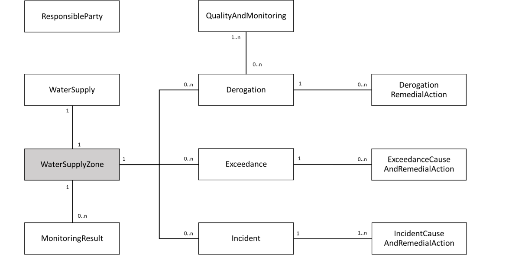
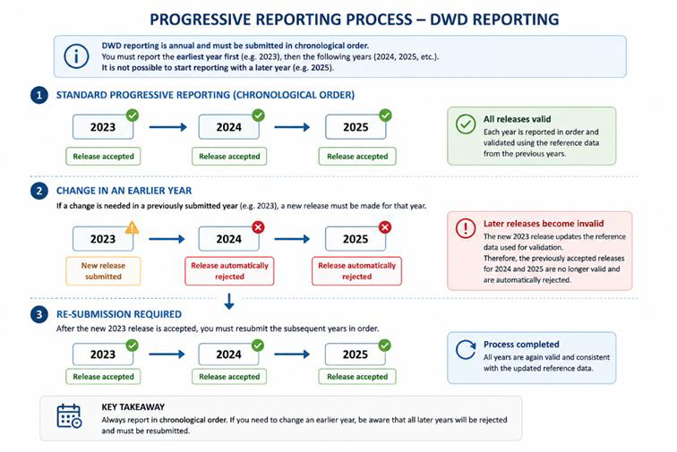
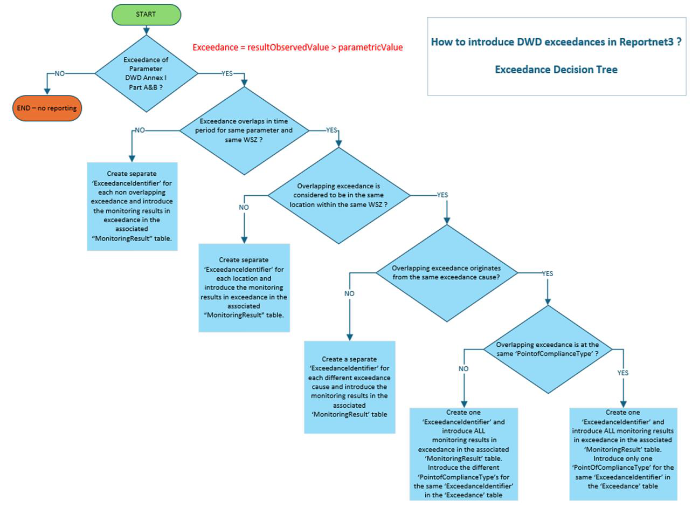

# Data sets on exceedances, incidents, and derogations (2025)

| List of Acronyms | |
|---|---|
| DWD | Drinking Water Directive |
| EEA | European Environment Agency |
| EU | European Union |
| WFD | Water Framework Directive |
| WSZ | Water Supply Zone |

## Introduction

### Purpose and structure of the document

The present document provides guidance to Member States in reporting the information required under article 18.1 (c), (d) and (e) of the [recast Drinking Water Directive](https://eur-lex.europa.eu/eli/dir/2020/2184/oj) 2020/2184/EC on the quality of water intended for human consumption. If you need further assistance, please contact dwd.helpdesk@eionet.europa.eu.
The document consists of three chapters.
- Chapter 1 gives information about the legal context, rules, components, and purpose of the reporting.
- Chapter 2 describes the data content and structure that must be followed to report the recast Drinking water Directive (DWD) annual data sets on exceedances, incidents, and derogations. Member States must follow the reporting templates when submitting the data in the [Reportnet 3 platform](https://reportnet.europa.eu/).
- Chapter 3 describes the data content and structure that must be followed to report the DWD reference spatial data sets. It refers to the WISE GIS Guidance which describes the structure of water supply zones spatial data set.

### Legal context and general approach of the recast DWD reporting

By January 2023, pursuant to Article 18.1 (c), (d) and (e) of the recast DWD, Member States have to set up data sets containing monitoring results on exceedances, information on incidents, and derogations. Member States must update these data sets annually thereafter. Pursuant to Article 18.2 of the recast DWD, Member States must ensure that the European Commission, the European Environment Agency (EEA) and the European Centre for Disease Prevention and Control have access to the data sets.
To harmonise the Member States' data sets and the data transfer to the European Commission, whilst considering the technical reporting possibilities within the Member States, DG Environment has organised several workshops on the recast DWD reporting. Based on the workshops held in 2021 and 2022, a reporting template and a reporting mechanism were defined. The reporting template will enable Member States to report the DWD annual data sets on exceedances, incidents, and derogations via the EEA [Reportnet 3 platform](https://reportnet.europa.eu/). 
The following general principles will be applied to the recast DWD reporting:
- The reporting shall cover water intended for human consumption. Water intended for human consumption means:
  - all water, intended for drinking, cooking, food preparation or other domestic purposes in both public and private premises, whether in its original state or after treatment, and regardless of its origin and whether it is supplied from a distribution network, supplied from a tanker or put into bottles or containers, including spring waters;
  - all water used in any food business for the manufacture, processing, preservation or marketing of products or substances intended for human consumption.
- The reporting shall cover, as a minimum, all individual supplies of water that provide 10 m3 per day or more as an average and serve 50 persons or more.
- The reporting shall be carried out annually.

### General rules for the reporting

The following general rules apply to the reporting under Article 18.1 (c), (d) and (e) of the recast DWD:
- Reporting by Member States to the European Commission shall be made in electronic format to the EEA Reportnet 3 platform.
- The data to be submitted shall be in accordance with the Article 18 provisions of the recast DWD. Supportive information may be supplied by the Member States in the form of document files but that is not mandatory.
- The data shall be structured according to the reporting format (templates) and modalities described in this document.
- Descriptive data can be structured using an Excel reporting template, to facilitate the data transfer.1
- Spatial reference data can be structured using a Geopackage template, to facilitate the data transfer.1
- Member States shall be responsible for the annually updated data set reporting to the European Commission and for the accuracy of the reported data.

### Components of the reporting

In line with the requirements under article 18.1 (c), (d) and (e) of the recast DWD 2020/2184/EC, the reporting contains descriptive data sets on competent authorities, exceedances, incidents, derogations, and monitoring results. The water supply zone is the reporting unit for the data on exceedances, incidents, derogations, and monitoring results. The water supply zones are defined by the Member States. A water supply zone is a geographically defined area within which water intended for human consumption comes from one or more sources and within which the water quality can be considered a being approximately uniform. Water supply zones should be reported using NUTS3 codes but can also be reported using a spatial data set.

The descriptive data sets are described in Chapter 2 and include:
- General information on **competent authorities**, i.e., the parties responsible for the reporting.
- **Monitoring results**, in the case of **exceedances** of the parametric values set out in Parts A and B of Annex I of the recast DWD, collected in accordance with Articles 9 and 13 and information about the **remedial actions** taken in accordance with Article 14. (Article 18.1.c – Exceedances, reported annually).
- Information on **incidents** relating to water intended for human consumption that have caused a potential risk to human health, regardless of whether any failure to meet the parametric values occurred, that lasted for more than 10 consecutive days and that affected at least 1 000 people, including the causes of those incidents and remedial actions taken in accordance with Article 14. (Article 18.1.d – Incidents, reported annually).
- Information on all **derogations** granted in accordance with Article 15(1), including the information provided for in Article 15(2). (Article 18.1.e – Derogations, reported annually).

The spatial data set is described in Chapter 3, which contains the WISE GIS Guidance DWD annex.

Figure 1: Reporting tables and main relationships between tables.

### How the European Comission and the EEA will use the information

The information provided annually by the Member States under Article 18.1 (c), (d) and (e) of the recast DWD will be used for the following purposes:
- To assess whether the implementation of the requirements of the recast DWD is sufficient in each Member State (i.e., compliance assessment).
- To enable the European Commission to monitor and assess the implementation of the recast DWD in relation to the objectives it pursues, to inform any future evaluation of this Directive in accordance with paragraph 22 of the Interinstitutional Agreement of 13 April 2016 on Better Law-Making.
- At EU and Member State level, for the assessment of critical pollutants that lead to exceedances on parametric values, and of the main categories of incidents.
- According to Article 18.3 of the recast DWD, the EEA shall publish and update a Union-wide overview using the data provided by the Member States on a regular basis or upon request from the European Commission.

The water supply zone is the reporting unit used in the data sets required by article 18.1 (c), (d) and (e) of the DWD, when reporting the annual data on exceedances, incidents and derogations, their causes and the remedial actions taken.
The data assessed by the European Commission can be presented at water supply zone level, and as aggregated information at national and EU levels. The European Commission requires data at water supply zone level to properly assess the DWD implementation.

In addition, the EEA may use the information to supplement the data collected through other reporting streams when producing European, pan-European and regional integrated environmental data and indicator sets, assessments and thematic analyses.

### Information Note on Progressive Reporting for Member States

Please take the following into account when preparing and submitting reports.
DWD reporting follows an annual reporting cycle and must be submitted in chronological order. This means that reporting must begin with the earliest reporting year (e.g. 2023), followed by subsequent years (2024, 2025, etc.). It is not possible to start reporting directly with a later year such as 2025.
As a result, the following situation may occur: If releases for 2023, 2024, and 2025 have already been submitted and accepted, and a correction is subsequently required for the 2023 release, a new release for 2023 must be submitted. Once this updated 2023 is released, the previously accepted releases for 2024 and 2025 will automatically be rejected. This is because the updated 2023 release modifies the reference data used during the validation process. Consequently, the later releases (2024 and 2025), which were validated against the previous version of the reference data, are no longer considered valid and must be resubmitted and validated against the updated reference data.

 
Figure 2: Reporting process Schema

## Decripive data for the recast DWD reporting

### Introduction

Chapter 2 provides instructions to assist the Member States on reporting the information about exceedances, incidents, and derogations, as required under article 18.1 (c), (d) and (e) of the recast DWD 2020/2184/EC. 
The content of the descriptive data reporting template is briefly described in Table 1 below.

Table 1: Tables in the descriptive data reporting template.
| Scope | Table name | Content |
|---|---|---|
| DWD Competent Authorities | ResponsibleParty | Contact information of the reporting responsible party |
| DWD Derogation under Article 15(1) | Derogation | General information on the derogations |
| DWD Derogation under Article 15(1) | DerogationRemedialAction | Information on the remedial actions for each derogation |
| DWD Derogation under Article 15(1) | QualityAndMonitoring | Information on quality and monitoring scheme requirements for the parameter of the derogation. |
| DWD Incidents and Exceedances | Incident | General information on the incidents |
| DWD Incidents and Exceedances | IncidentCauseAndRemedialAction | Information on causes for the reported incidents and remedial actions |
| DWD Incidents and Exceedances | Exceedance | General information on exceedances |
| DWD Incidents and Exceedances | ExceedanceCauseRemedialAction | Information on causes for the reported exceedances and remedial actions |
| DWD Water Supply and Monitoring Results | MonitoringResult | Monitoring results in case of derogations and exceedances |
| DWD Water Supply and Monitoring Results | WaterSupply | Information on the annual water supply and |

### Information on the authority responsible for reporting

**Table: ResponsibleParty**
***********************************

| Property | Value |
|----------|--------|
| Description | The ResponsibleParty table contains the information allowing the identification and contact with the competent authority responsible for reporting under the recast DWD. |
| Guidance | Reporting is required. |

| Code | Description |
|------|-------------|
| QC T001 | Mandatory table has no records |
| QC TU001 | Uniqueness and multiplicity constraints - The field responsiblePartyIdentifier is unique within table. |
| QC RF009 | You need to report first the data in the previous reporting cycle. |

**Field: responsiblePartyIdentifier**

| Property | Value |
|----------|--------|
| Data type | wiseIdentifier |
| Cardinality | [1] |
| Description | Unique European identifier for the competent authority |
| Guidance | Reporting is required. Provide a unique identifier code for each competent authority in charge of the DWD reporting. The identifier must also be used in subsequent reference years. The identifier must follow the syntax of the WISE identifiers. It must start with the two-letter country code of the Member State, followed by one character that can be a digit or an uppercase letter, followed by a sequence of characters (0 to 38 characters long) that can be digits or uppercase letters, with no consecutive double hyphens or double underscores, but allowing for single hyphens or underscores between characters. The code can optionally end with one character that can be a digit or an uppercase letter. Example: FR123, FR1_XYZ1234_1, FR1-XYZ1234-1, FR1XYZ12341 but not FR1__XYZ1234__1 or FR1--XYZ1234--1. |

| Code | Description |
|------|-------------|
| QC V001 | The value must not be missing or empty |
| QC V092 | The wiseIdentifier does not have the acceptable format |

**Field: organisationName**

| Property | Value |
|----------|--------|
| Data type | Text (250 characters) |
| Cardinality | [1] |
| Description | Official name of the competent authority, in English. |
| Guidance | Reporting is required. |

| Code | Description |
|------|-------------|
| QC V031 | The value must not be missing or empty |
| QC V080 | Text is too long (max 250 characters) |

**Field: electronicMailAddress**

| Property | Value |
|----------|--------|
| Data type | Text (50 characters) |
| Cardinality | [1] |
| Description | E-mail address of the competent authority. |
| Guidance | Reporting is required. |

| Code | Description |
|------|-------------|
| QC V002 | The value must not be missing or empty |
| QC V079 | Text is too long (max 50 characters) |

**Field: link**

| Property | Value |
|----------|--------|
| Data type | URL |
| Cardinality | [0..1] |
| Description | URL of competent authority's website. |
| Guidance | Reporting is optional. |

| Code | Description |
|------|-------------|
| QC V070 | The value does not follow the expected syntax for a valid URL |

### Information on DWD Derogations under Article 15(1)

Under the DWD 98/83/EC, granted derogations in Member States were communicated and/or requested to the European Commission disconnected from the DWD reporting. 
Under the recast DWD, information on Member States' derogations is integrated in the Article 18 reporting requirements. Article 18.1(e) of the recast DWD requires Member States to set up, and update annually thereafter, a data set containing information on all derogations granted in accordance with Article 15(1), including the information provided for in Article 15(2). 
Each year, all derogations must be reported, not just those granted during the reference year. This reporting is in addition to the communication requirements from Member States to the Commission in accordance with Article 15 of the recast DWD.

**Table: Derogation**
***********************

| Property | Value |
|----------|--------|
| Description | The table Derogation provides a unique identifier and a general description of each derogation. |
| Guidance | Reporting is conditional. |
| Guidance | The Derogation table must be reported for all derogations in place for the reference year. If a Derogation has been reported in the previous reference year but is still ongoing, it must be reported again. |
| Guidance | Information is required for: a) all derogations granted for parameters for which the parametric values are set out in Part B of Annex I of the recast DWD; and b) all derogations granted for additional parameters not included in Annex I for which a parametric value is set out by the Member State in accordance with Article 5(3) of the recast DWD, where the protection of human health within its national territory or part of it so requires. |

| Code | Description |
|------|-------------|
| QC TU002 | Uniqueness and multiplicity constraints - The field derogationIdentifier is unique within table. |
| QC R060 | Derogations cannot overlap in time for a given water supply zone and parameter. |
| QC R077 | There is no monitoring result reported for the derogationIdentifier. |
| QC RF006 | If a Derogation was reported for the previous reference year with EndDate falling in a following year, it must be reported again for the current reference year. |
| QC XC001 | Each derogation where trivialDerogation = 'no' in the Derogation table, must have at least one corresponding record in the DerogationRemedialAction table. |

**Field: derogationIdentifier**

| Property | Value |
|----------|--------|
| Data type | wiseIdentifier |
| Cardinality | [1] |
| Description | Unique European identifier for the derogation |
| Guidance | Reporting is required. |
| Guidance | Provide a unique identifier code for the derogation. The identifier must also be used in subsequent reference years if the derogation is still in place. The identifier must follow the syntax defined for WISE identifiers (see the guidance for the responsiblePartyIdentifier element and associated examples: FR123, FR1_XYZ1234_1, FR1-XYZ1234-1, FR1XYZ12341). |

| Code | Description |
|------|-------------|
| QC V003 | The value must not be missing or empty |
| QC V093 | The wiseIdentifier does not have the acceptable format |
| QC RF001 | DerogationIdentifier must be unique historically |
| QC RF005 | This derogation ended in the previous reference period |

**Field: trivialDerogation**

| Property | Value |
|----------|--------|
| Data type | SpecialValue code list value ('yes', 'no') |
| Cardinality | [1] |
| Description | Was the derogation granted for a trivial exceedance and the problem remedy within 30 days? |
| Guidance | Reporting is required. |
| Guidance | According to Art. 15(3) of the recast DWD, this field means: if the responsible authorities consider the non-compliance with the parametric value to be trivial, and if action taken in accordance with Article 14(2) is sufficient to remedy the problem within 30 days. |

| Code | Description |
|------|-------------|
| QC V042 | The value must not be missing or empty |
| QC V071 | The value is not a valid boolean value |
| QC V158 | The value must match one of the predefined list entries. |
| QC R047 | Trivial derogation lasts longer than 30 days |
| QC R071 | Non-trivial derogations cannot have endDate = 9999-12-31 |

**Field: trivialDerogationJustification**

| Property | Value |
|----------|--------|
| Data type | Text (1500 characters) |
| Cardinality | [0..1] |
| Description | If trivialDerogation = 'yes', provide a justification why the derogation was considered trivial. |
| Guidance | Reporting is conditional. |

| Code | Description |
|------|-------------|
| QC V090 | Text is too long ( max 1500 characters) |
| QC R016 | The value must not be missing or empty, if the derogation is trivial |

**Field: derogationStartDate**

| Property | Value |
|----------|--------|
| Data type | Date |
| Cardinality | [0..1] |
| Description | Start date of the derogation in the format YYYY-MM-DD |
| Guidance | Reporting is conditional. |

| Code | Description |
|------|-------------|
| QC V045 | The value is not a valid date (YYYY-MM-DD) |
| QC V152 | All start dates must be either within or earlier than the reference period. |
| QC R012 | The value must not be missing or empty, if the derogation is non-trivial |
| QC R064 | If derogationEndDate has been reported, derogationStartDate must be reported. |
| QC XC039 | The derogationStartDate must be greater than or equal to the designationPeriodBegin of the associated water supply zone |

**Field: derogationEndDate**

| Property | Value |
|----------|--------|
| Data type | Date |
| Cardinality | [0..1] |
| Description | End date of the derogation in the format YYYY-MM-DD |
| Guidance | Reporting is conditional. |

| Code | Description |
|------|-------------|
| QC V046 | The value is not a valid date (YYYY-MM-DD) |
| QC R010 | The value must not be missing or empty, if the derogation is non-trivial |
| QC R021 | The value must be higher or equal than derogationStartDate |
| QC R065 | If derogationStartDate is reported then derogationEndDate must be reported and within 30 days |
| QC RF002 | derogationEndDate must be equal to or earlier than designationPeriodEnd of the related and deleted water supply zone. |

**Field: volumeOfWaterSupplied**

| Property | Value |
|----------|--------|
| Data type | Non-negative integer |
| Cardinality | [0..1] |
| Description | Average daily volume of water supplied affected by the derogation, in cubic metres per day (m3/day). |
| Guidance | Reporting is conditional. |

| Code | Description |
|------|-------------|
| QC V062 | The value is not a valid whole number. |
| QC V094 | The value is not a valid non-negative number. |
| QC R018 | The value must not be missing or empty, if the derogation is non-trivial. |

**Field_ foodProductionAffected**

| Property | Value |
|----------|--------|
| Data type | Non-negative integer |
| Cardinality | [0..1] |
| Description | Estimated total number of people affected by the derogation in the water supply zone. |
| Guidance | Reporting is conditional. |

| Code | Description |
|------|-------------|
| QC V061 | The value is not a valid whole number. |
| QC V095 | The value is not a valid non-negative number. |
| QC R009 | The value must not be missing or empty, if the derogation is non-trivial. |

**Field: foodProductionAffected**

| Property | Value |
|----------|--------|
| Data type | SpecialValue code list value ('yes', 'no') |
| Cardinality | [0..1] |
| Description | Are any food-production undertakings being supplied with drinking water affected by the derogation? |
| Guidance | Reporting is conditional. |

| Code | Description |
|------|-------------|
| QC V072 | The value is not a valid boolean value. |
| QC R014 | The value must not be missing or empty, if the derogation is non-trivial. |

**Field: derogationUnderRecastDWD**

| Property | Value |
|----------|--------|
| Data type | SpecialValue code list value ('yes', 'no') |
| Cardinality | [1] |
| Description | Is the derogation granted according to the recast DWD? |
| Guidance | Reporting is required. |

| Code | Description |
|------|-------------|
| QC V073 | The value is not a valid boolean value. |
| QC V155 | The value must not be missing or empty. |
| QC V160 | The value must match one of the predefined list entries. |
| QC R013 | If trivialDerogation = 'yes', then derogationUnderRecastDWD must be 'yes'. |

**Field: derogationGrounds**

| Property | Value |
|----------|--------|
| Data type | DerogationGround code list value |
| Cardinality | [0..1] |
| Description | Grounds of the derogation. |
| Guidance | Reporting is conditional. “other” should be used in case of multiple grounds for the derogation. |

| Code | Description |
|------|-------------|
| QC V125 | The value is not a valid member of the referenced list. |
| QC R011 | The value must not be missing or empty, if the derogation is non-trivial. |

**Field: previousDerogationIdentifier**

| Property | Value |
|----------|--------|
| Data type | wiseIdentifier |
| Cardinality | [0..1] |
| Description | Unique European identifier for the previous derogation. |
| Guidance | Reporting is conditional. |
| Guidance | If a previous derogation exists for the same monitoring parameters and the same water supply zone, report the derogationIdentifier of the previous derogation. Note that in the 1st reporting under the recast DWD, the previous derogation identifiers will not exist in the Reportnet3 system: if that is the case, an identifier must be created by the data provider. The identifier must follow the syntax defined for WISE identifiers (see the guidance for the responsiblePartyIdentifier element and associated examples: FR123, FR1_XYZ1234_1, FR1-XYZ1234-1, FR1XYZ12341). In subsequent reporting cycles, the identifiers of the previously reported derogations will be available in the Reportnet3 system. |

| Code | Description |
|------|-------------|
| QC V141 | The wiseIdentifier does not have the acceptable format. |
| QC R040 | If previousDerogationIdentifier exists, then the derogation parameter(s) must be the same. |
| QC R066 | If a previous derogation is explicitly reported, it must have the same water supply zone, parameter and startDate as the reference derogation. |
| QC R069 | Derogation cannot overlap in time for a given water supply zone and parameter with its predecessor. |

**Field: previousDerogationConclusions**

| Property | Value |
|----------|--------|
| Data type | Text (1500 characters) |
| Cardinality | [0..1] |
| Description | Conclusions from the review of the previous derogation. This field should summarise the review carried out towards the end of the previous derogation to determine whether sufficient progress has been made. |
| Guidance | Reporting is conditional. |

| Code | Description |
|------|-------------|
| QC R001 | The value must not be missing or empty, if a previous derogation exists. |

**Field: previousDerogationStartDate**

| Property | Value |
|----------|--------|
| Data type | Date |
| Cardinality | [0..1] |
| Description | Start date of the previous derogation, in the format YYYY-MM-DD. |
| Guidance | Reporting is conditional. |

| Code | Description |
|------|-------------|
| QC V057 | The value is not a valid date (YYYY-MM-DD). |
| QC R005 | The value must not be missing or empty, if a previous derogation exists. |

**Field: previousDerogationEndDate**

| Property | Value |
|----------|--------|
| Data type | Date |
| Cardinality | [0..1] |
| Description | End date of the previous derogation, in the format YYYY-MM-DD. |
| Guidance | Reporting is conditional. |

| Code | Description |
|------|-------------|
| QC V059 | The value is not a valid date (YYYY-MM-DD). |
| QC R002 | The value must not be missing or empty, if a previous derogation exists. |
| QC R027 | The value must be higher than previousDerogationStartDate. |

**Field: previousDerogationGrounds**

**Data type**: DerogationGround code list value 
**Cardinality**: [0..1] 
**Description**: Legal grounds of the previous derogation. 
**Guidance**: Reporting is conditional. 
**QC V128**: The value is not a valid member of the referenced list. 
**QC R004**: The value must not be missing or empty, if a previous derogation exists.

**Field: reportingUnitIdentifier**

**Data type**: wiseIdentifier 
**Cardinality**: [1] 
**Description**: Provide the unique European identifier for the water supply zone. Note that in the WaterSupplyZone data set, the European identifier is reported in the thematicIdIdentifier field. 
**Guidance**: Reporting is required. 
The water supply zone must exist in the spatial reference data set WaterSupplyZone. 
**QC V020**: The value must not be missing or empty. 
**QC V111**: The value is not a valid member of the referenced list. 
**QC XC048**: The reported reportingUnitIdentifier, must exist in the WaterSupply table.

**Field: qualityAndMonitoringRequirementIdentifier**

**Data type**: wiseIdentifier 
**Cardinality**: [0..n] 
**Description**: Unique European identifier(s) for the quality and the monitoring requirement, as reported in the QualityAndMonitoring table. The field value links the derogation to each of the applicable monitoring scheme, parameter and respective maximum permissible value. 
**Guidance**: Reporting is conditional. 
Note that multiple values are possible, i.e., a derogation can be linked to more than one monitoring scheme. Multiple values are reported using a semicolon-separated list. 
**QC V129**: The value is not a valid member of the referenced list. 
**QC R015**: The value must not be missing or empty, if the derogation is non-trivial. 
**QC XC006**: Each derogation may have more than one associated record in the QualityAndMonitoring table if and only if the associated records have different parameterCode values.

**Field: remarks**

**Data type**: Text (1500 characters) 
**Cardinality**: [0..1] 
**Description**: Additional information about the record, in English or in the national language. 
**Guidance**: Reporting is conditional. 
**QC V081**: Text is too long (max 1500 characters). 
**QC R028**: If derogationGrounds = 'other', reporting is required.

**Table: DerogationRemedialAction**
****************************************

**Description**: In the DerogationRemedialAction table, information shall be reported about the remedial actions linked to all non-trivial derogations. For trivial derogations, reporting is optional. 
**Guidance**: Reporting is conditional. 
Note that each derogation may be associated with more than one remedial action. 
Therefore, multiple records of the DerogationRemedialAction table can have the same derogationIdentifier. 
**QC TU010**: Uniqueness and multiplicity constraints - The fields derogationIdentifier and derogationRemedialAction are uniques within table. 
**QC RF007**: The combination of derogationIdentifier and derogationRemedialAction must be unique historically. 
**QC RF020**: If a DerogationRemedialAction was reported for the previous reference year with EndDate falling in a following year or equal to 9999-12-31, it must be reported again for the current reference year.

**Field: derogationIdentifier**

**Data type**: wiseIdentifier 
**Cardinality**: [1] 
**Description**: Unique European identifier of the derogation, as reported in the Derogation table. 
**Guidance**: Reporting is required. 
**QC V034**: The value must not be missing or empty. 
**QC V133**: The derogationIdentifier must exists in table Derogation if the derogation is still open in this reporting cycle.

**Field: derogationRemedialAction**

**Data type**: RemedialAction code list value 
**Cardinality**: [1] 
**Description**: Report the remedial action for the derogation. 
**Guidance**: Reporting is required. 
**QC V132**: The value is not a valid member of the referenced list. 
**QC V156**: Checks if the field is missing or empty. 
**QC R062**: The option derogationRemedialAction = 'none' is incompatible with any other option.

**Field: derogationRemedialActionStartDate**

**Data type**: Date 
**Cardinality**: [0..1] 
**Description**: Start date of the remedial action, in the format YYYY-MM-DD. 
**Guidance**: Reporting is conditional. 
**QC V049**: The value is not a valid date (YYYY-MM-DD). 
**QC R033**: If derogationRemedialAction is not 'none', then the derogationRemedialActionStartDate is required.

**Field: derogationRemedialActionEndDate**

**Data type**: Date 
**Cardinality**: [0..1] 
**Description**: End date of the remedial action, in the format YYYY-MM-DD. 
**Guidance**: Reporting is conditional. 
The end date of the remedial action corresponds to the date until which the remedial action is planned. If the endDate is known, then report the real date; if unknown, report 9999-12-31. 
**QC V050**: The value is not a valid date (YYYY-MM-DD). 
**QC R022**: The value must be greater than or equal than derogationRemedialActionStartDate. 
**QC R034**: If derogationRemedialAction is not 'none', then the derogationRemedialActionEndDate is required.

**Field: derogationRemedialActionCost**

**Data type**: Non-negative integer 
**Cardinality**: [0..1] 
**Description**: Total cost of the remedial action, in Euro (€). 
**Guidance**: Reporting is conditional. 
**QC V063**: The value is not a valid whole number. 
**QC V096**: The value is not a valid non-negative number. 
**QC R035**: If derogationRemedialAction is not 'none', then the derogationRemedialActionCost is required.

**Field: remarks**

**Data type**: Text (1500 characters) 
**Cardinality**: [0..1] 
**Description**: Additional information about the record, in English or in the national language. 
**Guidance**: Reporting is optional. 
**QC V082**: Text is too long (max 1500 characters).

**Table: QualityAndMonitoring**
***********************************

**Description**: In the QualityAndMonitoring table, information shall be reported on the parameters of non-trivial derogations and on the appropriate monitoring scheme specified in the derogation in accordance with the Article 15(2)(d) requirements of the recast DWD. 
**Guidance**: Reporting is conditional. 
Non-trivial derogations must be associated with one or more quality and monitoring requirement. Note that the same quality and monitoring requirements may apply to more than one derogation. 
**QC TU003**: Uniqueness and multiplicity constraints - The field qualityAndMonitoringRequirementIdentifier is unique within table. 
**QC R032**: The combination of the values for parameterCode, parameterThresholdValue, parameterThresholdValueUnit, samplingFrequency, samplingPeriod, and samplingLocationType must be unique. 
**QC XC049**: If a qualityAndMonitoringRequirementIdentifier is reported in the QualityAndMonitoring table, the same identifier must appear in the Derogation table.

**Field: qualityAndMonitoringRequirementIdentifier**

**Data type**: wiseIdentifier 
**Cardinality**: [1] 
**Description**: Unique identifier for the quality and monitoring requirement. 
**Guidance**: Reporting is required. 
Provide a unique identifier code for the quality and monitoring requirement. The identifier must follow the syntax defined for WISE identifiers (see the guidance for the responsiblePartyIdentifier element). 
The identifier must also be used in subsequent reference years if the requirement is still applicable. A register will be kept with the previously reported quality and monitoring requirements. In other words, the quality and monitoring requirements only need to be reported once and their identifier can be reused in future reporting cycles. 
**QC V004**: The value must not be missing or empty. 
**QC V097**: The wiseIdentifier does not have the acceptable format.

**Field: parameterCode**

**Data type**: Parameter code list value 
**Cardinality**: [1] 
**Description**: Parameter which is part of the derogation. 
**Guidance**: Reporting is required. 
Use the code provided in the Parameter code list. If a specific parameter is not present in the code list, please contact dwd.helpdesk@eionet.europa.eu. 
**QC V035**: The value must not be missing or empty. 
**QC V134**: The value is not a valid member of the referenced list.

**Field: parameterThresholdValue**

**Data type**: Non-negative decimal 
**Cardinality**: [1] 
**Description**: Maximum permissible parametric (threshold) value of the parameter, in the unit of measure reported in the parameterThresholdValueUnit field. 
**Guidance**: Reporting is required. 
**QC V036**: The value must not be missing or empty. 
**QC V055**: The value is not a valid whole or decimal number. 
**QC V098**: The value is not a valid non-negative number.

**Field: parameterThresholdValueUnit**

**Data type**: UnitOfMeasure code list value 
**Cardinality**: [1] 
**Description**: Unit of measure for the value reported in the parameterThresholdValue field. 
**Guidance**: Reporting is required. 
Use the code in the UnitOfMeasure code list. If a specific unit of measure is not present in the code list, please contact dwd.helpdesk@eionet.europa.eu. 
**QC V037**: The value must not be missing or empty. 
**QC V135**: The value is not a valid member of the referenced list. 
**QC XC017**: If there's a unit of measure in the record, it needs to be the same that is specified in the codelist table ([unitOfMeasure]).

Table 2: Overview of parameters with differing UnitOfMeasure between Annex I of the recast DWD and Reportnet 3.
| Description of parameterCode | Annex I of the recast DWD |  | To use in Reportnet 3 |  |
|---|---:|---|---:|---|
|  | parametricValue | UnitOfMeasure | parametricValue | UnitOfMeasure |
| CAS_14797-55-8 - Nitrate | 50 | mg/l | 50 | mg{NO3}/L |
| CAS_14797-65-0 - Nitrite | 0,5 | mg/l | 0,5 | mg{NO2}/L |
| CAS_14798-03-9 - Ammonium | 0,5 | mg/l | 0,5 | mg{NH4}/L |
| CAS_14866-68-3 - Chlorates | 0,25 | mg/l | 250 | ug/L |
| CAS_14998-27-7 - Chlorite | 0,25 | mg/l | 250 | ug/L |
| CAS_16984-48-8 - Fluoride | 1,5 | mg/l | 1500 | ug/L |
| CAS_7440-42-8 - Boron | 1,5 | mg/l | 1500 | ug/L |
| CAS_7440-50-8 - Copper and its compounds | 2,0 | mg/l | 2000 | ug/L |
| EEA_15-02-1 - Intestinal enterococci | 0 | number/100 ml | 0 | [CFU]/dL |
| EEA_15-03-2 - Clostridium perfringens | 0 | number/100 ml | 0 | [CFU]/dL |
| EEA_15-04-3 - Coliform bacteria | 0 | number/100 ml | 0 | [CFU]/dL |
| EEA_15-05-4 - Legionella | <1000 | [CFU]/l | 100 | [CFU]/dL |

**Field: samplingFrequency**

**Data type**: Positive integer 
**Cardinality**: [1] 
**Description**: Number of samples per sampling period. 
**Guidance**: Reporting is required. 
The monitoring scheme is defined by the sampling frequency and the sampling period. The sampling frequency is an integer value, informing how often samples are collected within a sampling period of one day, week, month, or year. If sampling is conducted 4 times per year, then samplingFrequency = 4 and samplingPeriod = 'a'. If sampling is conducted twice a month, then samplingFrequency = 2 and samplingPeriod = 'mo'. If sampling is conducted once a day, then samplingFrequency = 1 and samplingPeriod = 'd'. 
**QC V038**: The value must not be missing or empty. 
**QC V047**: The value is not a valid whole number. 
**QC V099**: The value is not a valid non-negative number.

**Field: samplingPeriod**

**Data type**: SamplingPeriod code list value 
**Cardinality**: [1] 
**Description**: Sampling period (day, month, etc.). 
**Guidance**: Reporting is required. 
See guidance for the samplingFrequency field. 
**QC V039**: The value must not be missing or empty. 
**QC V136**: The value is not a valid member of the referenced list.

**Field: samplingLocationType**

**Data type**: PointOfComplianceType code list value 
**Cardinality**: [1..n] 
**Description**: Sampling location types where the monitoring requirements are applicable. 
**Guidance**: Reporting is required. 
More than one type of sampling location may be reported. Multiple options can be reported, using a semicolon-separated list. 
**QC V040**: The value must not be missing or empty. 
**QC V137**: The value is not a valid member of the referenced list.

**Field: remarks**

**Data type**: Text (1500 characters) 
**Cardinality**: [0..1] 
**Description**: Additional information about the record, in English or in the national language. 
**Guidance**: Reporting is optional. 
**QC V083**: Text is too long (max 1500 characters).

### Information on DWD Incidents

**Table: Incident**
************************

**Description**: Article 18.1(d) of the recast DWD requires Member States to set up, and update annually thereafter, a data set containing information on incidents relating to water intended for human consumption that have caused a potential risk to human health, regardless of whether any failure to meet the parametric values occurred, that lasted for more than ten (10) consecutive days and that affected at least 1 000 people, including the causes of those incidents and remedial actions taken in accordance with Article 14. 
In the Incident table, information shall be reported that allow for unique identification and general description of the respective incident. One incident is one event: one reporting unit, one incident cause and one time period and could affect multiple parts of the supply chain (i.e category). 
**Guidance**: Reporting is conditional. 
The table must be reported if incidents exist for the reference year. 
**QC TU004**: Uniqueness and multiplicity constraints - The field incidentIdentifier is unique within table. 
**QC R046**: Incident lasts less than or equal than 10 days. 
**QC R061**: Multiple incidents of the same cause overlapping in time are reported for the same water supply zone. Please, note that this is only allowed when the reported incidents are associated with different locations within the same water supply zone and overlapping in time. 
**QC RF014**: This incident ended in the previous reporting. 
**QC RF016**: If an Incident was reported for the previous reference year with EndDate equal to 9999-12-31, it must be reported again for the current reference year. 
**QC XC007**: All incidents reported in the Incident table must have at least one associated record in the IncidentCauseAndRemedialAction table.

**Field: incidentIdentifier**

**Data type**: wiseIdentifier 
**Cardinality**: [1] 
**Description**: Unique European identifier for the incident. 
**Guidance**: Reporting is required. 
Provide a unique identifier code for the incident. The identifier must follow the syntax defined for WISE identifiers (see the guidance for the responsiblePartyIdentifier element and associated examples: FR123, FR1_XYZ1234_1, FR1-XYZ1234-1, FR1XYZ12341). 
**QC V027**: The value must not be missing or empty. 
**QC V100**: The wiseIdentifier does not have the acceptable format.

**Field: reportingUnitIdentifier**

**Data type**: wiseIdentifier 
**Cardinality**: [1] 
**Description**: Unique European identifier of the water supply zone. 
**Guidance**: Reporting is required. 
Provide the unique identifier of the water supply zone. The water supply zone must exist in the spatial reference data set WaterSupplyZone. In the WaterSupplyZone data set, the European identifier is reported in the thematicIdIdentifier field. 
**QC V021**: The value must not be missing or empty. 
**QC V112**: The value is not a valid member of the referenced list. 
**QC XC045**: The incidentEndDate must be equal to or earlier than designationPeriodEnd of the related and deleted water supply zone. 
**QC XC047**: The reported reportingUnitIdentifier, must exist in the WaterSupply table.

**Field: incidentStartDate**

**Data type**: Date 
**Cardinality**: [1] 
**Description**: Start date of the incident, in the format YYYY-MM-DD. 
**Guidance**: Reporting is required. 
**QC V005**: The value must not be missing or empty. 
**QC V058**: The value is not a valid date (YYYY-MM-DD). 
**QC V153**: All start dates must be either within or earlier than the reference period. 
**QC XC041**: The incidentStartDate must be greater than or equal to the designationPeriodBegin of the associated water supply zone. 
**QC R068**: If the incidentEndDate has been reported, the incidentStartDate must be reported.

**Field: incidentEndDate**

**Data type**: Date 
**Cardinality**: [1] 
**Description**: End date of the incident, in the format YYYY-MM-DD. 
**Guidance**: Reporting is required. 
If the incident is still ongoing at the end of the year, report 9999-12-31. 
**QC V006**: The value must not be missing or empty. 
**QC V060**: The value is not a valid date (YYYY-MM-DD). 
**QC V148**: Incident end date outside reporting period. 
**QC R025**: The value must be greater than or equal than incidentStartDate. 
**QC XC045**: The incidentEndDate must be equal to or earlier than designationPeriodEnd of the related and deleted water supply zone. 
**QC XC037**: The end date of the remedial is greater than the end date of the incident.

**Field: incidentCategory**

**Data type**: IncidentCategory code list value 
**Cardinality**: [1..n] 
**Description**: Category of the incident. 
**Guidance**: Reporting is required. 
Use the code in the IncidentCategory code list. Multiple options can be reported, using a semicolon-separated list. 
**QC V007**: The value must not be missing or empty. 
**QC V131**: The value is not a valid member of the referenced list. 
**QC V142**: If multiple incidentCategory values are reported, all values must be distinct. 
**QC V143**: If incidentCategory = 'unknown' is incompatible with any other option.

**Field: incidentAffectedPopulation**

**Data type**: Non-negative integer 
**Cardinality**: [1] 
**Description**: Estimated number of people affected by the incident in the water supply zone. Affected population refers to the people potentially exposed to the risk, regardless of disease or not. 
**Guidance**: Reporting is required. 
**QC V101**: The value is not a valid non-negative number. 
**QC V032**: The value must not be missing or empty. 
**QC V067**: The value is not a valid whole number. 
**QC V145**: The incident affected less than 1000 people.

**Field: remarks**

**Data type**: Text (1500 characters) 
**Cardinality**: [0..1] 
**Description**: Additional information about the record, in English or in the national language. 
**Guidance**: Reporting is conditional. 
**QC R043**: If the incidentCategory = 'unknown' or if one of the incidentCategory values is 'other', additional explanation should be provided in the remarks field. 
**QC V084**: Text is too long (max 1500 characters).

**Table: IncidentCauseAndRemedialAction**
********************************************

**Description**: In the IncidentCauseAndRemedialAction table, information shall be reported about the cause and remedial actions linked to an incident previously reported in Incident table. Note that each incident can be associated with more than one remedial action. 
**Guidance**: Reporting is conditional. 
The table must be reported if incidents exist for the reference year. 
**QC TU006**: The combination of the incidentIdentifier value, incidentCause value and the incidentRemedialAction value must be unique across the IncidentCauseAndRemedialAction table records. 
**QC R041**: For each incidentIdentifier value, the number of acceptable different incidentCause values is one. 
**QC RF019**: If an IncidentRemedialAction was reported for the previous reference year with EndDate falling in a following year or equal to 9999-12-31, it must be reported again for the current reference year. 
**QC XC035**: The remedial action period must overlap, at least partially, with the associated incident period.

**Field: incidentIdentifier**

**Data type**: wiseIdentifier 
**Cardinality**: [1] 
**Description**: Unique European identifier of the incident, as reported in the Incident table. 
**Guidance**: Reporting is required. 
**QC V008**: The value must not be missing or empty. 
**QC V113**: The value is not a valid member of the referenced list.

**Field: incidentCause**

**Data type**: IncidentExceedanceCause code list value 
**Cardinality**: [1] 
**Description**: Cause of the incident. 
**Guidance**: Reporting is required. 
**QC V009**: The value must not be missing or empty. 
**QC V117**: The value is not a valid member of the referenced list.

**Field: incidentRemedialAction**

**Data type**: RemedialAction code list value 
**Cardinality**: [1] 
**Description**: Remedial action linked to an incident. 
**Guidance**: Reporting is required. 
Each incident is associated to one and only one cause, but multiple remedial actions may be reported. 
**QC V010**: The value must not be missing or empty. 
**QC V118**: The value is not a valid member of the referenced list. 
**QC R007**: If incidentRemedialAction = 'other', reporting is required. 
**QC R031**: If incidentRemedialAction = 'none', then no other record of the IncidentCauseAndRemedialAction table can have the same incidentIdentifier value.

**Field: incidentRemedialActionStartDate**

**Data type**: Date 
**Cardinality**: [0..1] 
**Description**: Start date of the remedial action, in the format YYYY-MM-DD. 
**Guidance**: Reporting is conditional. 
**QC V052**: The value is not a valid date (YYYY-MM-DD). 
**QC R036**: If incidentRemedialAction is not 'none', then the incidentRemedialActionStartDate is required. 
**QC XC051**: incidentRemedialActionStartDate and incidentRemedialActionEndDate should fall within incidentStartDate and incidentEndDate.

**Field: incidentRemedialActionEndDate**

**Data type**: Date 
**Cardinality**: [0..1] 
**Description**: End date of the remedial action, in the format YYYY-MM-DD. 
**Guidance**: Reporting is conditional. 
The end date of the remedial action corresponds to the date until which the remedial action is planned. If the end date is known, then report the real date; if unknown, report 9999-12-31. 
**QC V051**: The value is not a valid date (YYYY-MM-DD). 
**QC R026**: The value must be greater than or equal than incidentRemedialActionStartDate. 
**QC R037**: If incidentRemedialAction is not 'none', then the incidentRemedialActionEndDate is required.

**Field: remarks**

**Data type**: Text (1500 characters) 
**Cardinality**: [0..1] 
**Description**: Additional information about the record, in English or in the national language. 
**Guidance**: Reporting is conditional. 
**QC V085**: Text is too long (max 1500 characters). 
**QC R075**: If the main cause is unclear, select ‘unknown’ and provide explanations in the ‘remarks’ field.

### Information on DWD Exceedances

**Table: Exceedance**
*************************

**Description**: Article 18.1 (c) of the recast DWD requires Member States to set up, and update annually thereafter, a data set containing monitoring results, in cases of exceedances of the parametric values set out in Parts A and B of Annex I, collected in accordance with Articles 9 and 13 and information about the remedial actions taken in accordance with Article 14. 
All exceedances have to be reported, not just those related to a derogation. In the Exceedance table, information shall be reported that allows for unique identification and description of any exceedance. One exceedance corresponds to one reporting unit (water supply zone), one parameter, one cause and one time period. For exceedances at different locations that overlap in time, for the same parameter, cause and water supply zone, create separate records in the exceedance table, using different exceedanceIdentifier codes for different locations (see Figure 3). 
**QC TU005**: Uniqueness and multiplicity constraints - The field exceedanceIdentifier is unique within table. 
**QC R045**: Multiple exceedances of the same cause overlapping in time are reported for the same parameter and water supply zone. Please, note that this is only allowed when the reported exceedances occur at different locations within the same water supply zone. 
**QC RF015**: Reporting of an exceedance already present from the previous reporting, must be linked to the same water supply zone, derogationIdentifier and incidentIdentifier. 
**QC RF017**: If an Exceedance was reported for the previous reference year with EndDate equal to 9999-12-31, it must be reported again for the current reference year. 
**QC XC010**: All exceedances reported in the Exceedance table must have at least one associated record in the ExceedanceCauseAndRemedialAction table. 
**QC R076**: There is no monitoring result reported for the exceedanceIdentifier.

 
Figure 3: Exceedance Decision Tree - How to introduce DWD exceedances in Reportnet3?

**Field: exceedanceIdentifier**

**Data type**: wiseIdentifier 
**Cardinality**: [1] 
**Description**: Unique European identifier for the exceedance. 
**Guidance**: Reporting is required. Provide a unique identifier code for the exceedance. The identifier must follow the syntax defined for WISE identifiers (see the guidance for the responsiblePartyIdentifier element and associated examples: FR123, FR1_XYZ1234_1, FR1-XYZ1234-1, FR1XYZ12341). 
**QC V025**: The value must not be missing or empty. 
**QC V102**: The wiseIdentifier does not have the acceptable format. 
**QC RF010**: ExceedanceIdentifier must be unique historically. 
**QC RF013**: This exceedance ended in the previous reporting.

**Field: reportingUnitIdentifier**

**Data type**: wiseIdentifier 
**Cardinality**: [1] 
**Description**: Unique European identifier of the water supply zone. 
**Guidance**: Reporting is required. 
Provide the unique identifier of the water supply zone. The water supply zone must exist in the spatial reference data set WaterSupplyZone. In the WaterSupplyZone data set, the European identifier is reported in the thematicIdIdentifier field. 
**QC V022**: The value must not be missing or empty. 
**QC V114**: The value is not a valid member of the referenced list. 
**QC RF004**: The exceedanceEndDate must be equal to or earlier than designationPeriodEnd of the related and deleted water supply zone. 
**QC XC046**: The reported reportingUnitIdentifier, must exist in WaterSupply table.

**Field: trivialExceedance**

**Data type**: SpecialValue code list value ('yes', 'no') 
**Cardinality**: [1] 
**Description**: Was the exceedance considered trivial by the competent authority? 
**Guidance**: Reporting is required. 
**QC V043**: The value must not be missing or empty. 
**QC V074**: The value is not a valid boolean value. 
**QC V161**: The value must match one of the predefined list entries.

**Field: trivialExceedanceJustification**

**Data type**: Text (1500 characters) 
**Cardinality**: [0..1] 
**Description**: If trivialExceedance = 'yes', provide a justification why the exceedance was considered trivial. 
**Guidance**: Reporting is conditional. 
**QC V091**: Text is too long (max 1500 characters). 
**QC R017**: The value must not be missing or empty, if the exceedance is trivial.

**Field: parameterCode**

**Data type**: Parameter code list value 
**Cardinality**: [1] 
**Description**: Parameter whose parametric value has been exceeded. 
**Guidance**: Reporting is required. 
Use the code provided in the Parameter code list. If a specific parameter is not present in the code list, please contact dwd.helpdesk@eionet.europa.eu. For reporting an exceedance of the condition **[nitrate]/50 + [nitrite]/3 ≤ 1**, create two separate records in the Exceedance table, using two different exceedanceIdentifier codes (one for nitrate and one for nitrite). Use the ‚remarks‘ field of the MonitoringResult table to indicate the correct pairing of the two records, as explained below in the MonitoringResult table (Box 1). 
**QC V018**: The value must not be missing or empty. 
**QC V110**: The value is not a valid member of the referenced list.

**Field: exceedanceStartDate**

**Data type**: Date 
**Cardinality**: [1] 
**Description**: Start date of the exceedance, in the format YYYY-MM-DD. 
**Guidance**: Reporting is required. 
**QC V011**: The value must not be missing or empty. 
**QC V076**: The value is not a valid date (YYYY-MM-DD). 
**QC V154**: All start dates must be either within or earlier than the reference period. 
**QC XC038**: The exceedanceStartDate, must be greater or equal to the incidentStartDate. 
**QC XC040**: The exceedanceStartDate must be greater than or equal to the designationPeriodBegin of the associated water supply zone. 
**QC XC033**: The exceedance period must overlap, at least partially, with the associated derogation period.

**Field: exceedanceEndDate**

**Data type**: Date 
**Cardinality**: [1] 
**Description**: End date of the exceedance, in the format YYYY-MM-DD. 
**Guidance**: Reporting is required. 
If the exceedance is still ongoing at the end of the year, report 9999-12-31. 
**QC V012**: The value must not be missing or empty. 
**QC V077**: The value is not a valid date (YYYY-MM-DD). 
**QC R023**: The value must be greater than or equal than exceedanceStartDate. 
**QC V149**: Exceedance end date outside reporting period. 
**QC XC036**: The end date of the remedial is greater than the end date of the exceedance.

**Field: exceedanceAffectedPopulation**

**Data type**: Non-negative integer 
**Cardinality**: [1] 
**Description**: Estimated number of people affected by the exceedance in the water supply zone. 
**Guidance**: Reporting is required. 
**QC V028**: The value must not be missing or empty. 
**QC V064**: The value is not a valid whole number. 
**QC V103**: The value is not a valid non-negative number. 
**QC XC024**: The exceedanceAffectedPopulation value must be smaller or equal to the populationServed value of the water supply zone.

**Field: pointOfComplianceType**

**Data type**: PointOfComplianceType code list value 
**Cardinality**: [1..n] 
**Description**: Point of compliance type i.e., the type of the point where the parametric values set out in the Annex I, part A and B of the recast DWD must be complied with and where an exceedance was encountered. 
**Guidance**: Reporting is required. 
More than one type of point of compliance may be reported. Multiple options can be reported, using a semicolon-separated list. 
**QC V026**: The value must not be missing or empty. 
**QC V138**: The value is not a valid member of the referenced list. 
**QC V144**: If multiple pointOfComplianceType values are reported, they must all be distinct.

**Field: numberOfSamplesPerYear**

**Data type**: Non-negative integer 
**Cardinality**: [1] 
**Description**: Number of samples per year taken for monitoring the parameter in exceedance. 
**Guidance**: Reporting is required. 
Report the total number of samples taken in the corresponding one-year reporting period for the monitoring of the parameter in the water supply zone. 
If the numberOfSamplesPerYear is not compliant with the minimum number of samples to be taken defined in Annex II part B of the recast DWD, additional explanation should be provided in the remarks field. 
**QC V033**: The value must not be missing or empty. 
**QC V068**: The value is not a valid whole number. 
**QC V104**: The value is not a valid non-negative number.

**Field: remarks**

**Data type**: Text (1500 characters) 
**Cardinality**: [0..1] 
**Description**: Additional information about the record, in English or in the national language. 
**Guidance**: Reporting is conditional. 
If the numberOfSamplesPerYear is not compliant with the minimum number of samples to be taken defined in Annex II part B of the recast DWD, additional explanation should be provided in this remarks field. 
**QC V086**: Text is too long (max 1500 characters).

**Field: incidentIdentifier**

**Data type**: wiseIdentifier 
**Cardinality**: [0..1] 
**Description**: Unique European identifier of the incident, as reported in the Incident table. 
**Guidance**: Reporting is conditional. 
Report if and only if there is an Incident causing the Exceedance. If there is more than one incident related to an exceedance, report the main incident. 
**QC V123**: The value is not a valid member of the referenced list. 
**QC XC004**: The reportingUnitIdentifier must be consistent with the reportingUnitIdentifier from Incident. 
**QC XC025**: The exceedance period must partly overlap with the incident period.

**Field: derogationIdentifier**

**Data type**: wiseIdentifier 
**Cardinality**: [0..1] 
**Description**: Unique European identifier of the derogation, as reported in the Derogation table. 
**Guidance**: Reporting is conditional. 
Report if and only if there is a Derogation associated with the Exceedance (i.e., for the same water supply zone, parameter, and time frame). 
**QC V124**: The value is not a valid member of the referenced list. 
**QC XC012**: The exceedance parameter must be equal to a derogation parameter. 
**QC XC016**: The exceedance reportingUnitIdentifier must be equal to the derogation reportingUnitIdentifier. 
**QC XC026**: The exceedance period must be consistent with the derogation period (overlap, at least partly/be within).

**Table: ExceedanceCauseRemedialAction**
********************************************

**Description**: In ExceedanceCauseRemedialAction table, information about the cause and existing remedial actions for each exceedance in the Exceedance table. Note that each exceedance can be associated with more than one remedial action. 
**Guidance**: Reporting is conditional. 
The table must be reported if exceedances exist for the reference year. 
**QC TU007**: The combination of the exceedanceIdentifier value, exceedanceCause value and the exceedanceRemedialAction value must be unique across the ExceedanceCauseRemedialAction table records. 
**QC RF018**: If an ExceedanceRemedialAction was reported for the previous reference year with EndDate falling in a following year or equal to 9999-12-31, it must be reported again for the current reference year. 
**QC XC034**: The remedial action period must overlap, at least partially, with the associated exceedance period.

**Field: exceedanceIdentifier**

**Data type**: wiseIdentifier 
**Cardinality**: [1] 
**Description**: Unique European identifier of the exceedance, as reported in the Exceedance table. 
**Guidance**: Reporting is required. 
**QC V013**: The value must not be missing or empty. 
**QC V115**: The exceedanceIdentifier must exists in table exceedance if the exceedance is still open in this reporting cycle. 
**QC R063**: For each exceedanceIdentifier value, the number of acceptable different exceedanceCause values is one.

**Field: exceedanceCause**

**Data type**: IncidentExceedanceCause code list value 
**Cardinality**: [1] 
**Description**: Cause of the exceedance. 
**Guidance**: Reporting is required. Provide the original main cause. If the main cause is unclear, select ‘unknown’ and provide explanations in the ‘remarks’ field. If there are several independent causes, the Exceedance table should be completed again (using a new exceedanceIdentifier). 
**QC V014**: The value must not be missing or empty. 
**QC V119**: The value is not a valid member of the referenced list.

**Field: exceedanceRemedialAction**

**Data type**: RemedialAction code list value 
**Cardinality**: [1] 
**Description**: Remedial action linked to an exceedance. 
**Guidance**: Reporting is required. 
Each exceedance is associated to one and only one cause, but multiple remedial actions may be reported. 
**QC V015**: The value must not be missing or empty. 
**QC V130**: The value is not a valid member of the referenced list. 
**QC R030**: If exceedanceRemedialAction = 'none', then no other record of the IncidentCauseAndRemedialAction table can have the same exceedanceIdentifier value.

**Field: exceedanceRemedialActionStartDate**

**Data type**: Date 
**Cardinality**: [0..1] 
**Description**: Start date of the remedial action, in the format YYYY-MM-DD. 
**Guidance**: Reporting is conditional. 
**QC V053**: The value is not a valid date (YYYY-MM-DD). 
**QC R038**: If exceedanceRemedialAction is not 'none', then the exceedanceRemedialActionStartDate is required.

**Field: exceedanceRemedialActionEndDate**

**Data type**: Date 
**Cardinality**: [0..1] 
**Description**: End date of the remedial action, in the format YYYY-MM-DD. 
The end date of the remedial action corresponds to the date until which the remedial action is planned. If the endDate is known, then report the real date; if unknown, report 9999-12-31. 
**Guidance**: Reporting is conditional. 
**QC V054**: The value is not a valid date (YYYY-MM-DD). 
**QC R024**: The value must be greater than or equal than exceedanceRemedialActionStartDate. 
**QC R039**: If exceedanceRemedialAction is not 'none', then the exceedanceRemedialActionEndDate is required.

**Field: remarks**

**Data type**: Text (1500 characters) 
**Cardinality**: [0..1] 
**Description**: Additional information about the record, in English or in the national language. 
**Guidance**: Reporting is conditional. 
**QC V087**: Text is too long (max 1500 characters). 
**QC R042**: If exceedanceRemedialAction = 'other', reporting is required. 
**QC R074**: If the main cause is unclear, select ‘unknown’ and provide explanations in the ‘remarks’ field.

### Information on DWD Monitoring Results

**Table: MonitoringResult**
******************************

**Description**: The MonitoringResult table contains information about the monitoring data for each parameter. 
**Guidance**: Reporting is conditional. 
The MonitoringResult table is required to report the monitoring data for each parameter in exceedance and under non-trivial derogation. In case of a non-trivial derogation previous monitoring results needs to be reported. 
Parameters not in exceedance or not under a derogation must not be reported. For trivial derogations, reporting is optional. 
The table must be completed with:
- All monitoring results relevant to an exceedance (only exceeding values).
- Previous monitoring results used for granting a non-trivial derogation. 'Previous monitoring results' should be interpreted as the monitoring results, <u>in exceedance or not</u>, for the three previous years before the date the derogation was granted.

**QC R056**: Justification has been provided for some missing values. 
**QC R072**: If 'EEA_15-01-0 - Escherichia coli' is reported, please enter the method of analysis used in the “remarks" field, either 'EN ISO 9308-1' or 'EN ISO 9308-2'. 
**QC XC042**: Validation of paired Nitrate and Nitrite observed values per sample, WSZ, and date. It checks that for the same sample, WSZ and date, nitrate and nitrite observed values, if reported, are paired. 
**QC R073**: Remarks must be provided when Nitrate or Nitrite observed values are below or equal to their respective parametric values. For reported observed values for nitrate or nitrite, it checks that, if the resultObservedValue&lt;= parametricValue, the 'remarks' field is filled in. 
**QC XC043**: Mismatch in reciprocal references between Nitrate and Nitrite observed values for same date, sample and WSZ. It checks that if a nitrate observed value X is paired (in the relevant 'remarks' field) with a nitrite observed value Y, this nitrite observed value Y is paired (in the relevant 'remarks' field) with the nitrate observed value X. 
**QC R078**: At least an exceedanceIdentifier or a derogationIdentifier must be reported. 
**QC XC044**: The related Exceedance_ID used in the 'Remarks' field must exist as an exceedance identifier in the MonitoringResult table within the same sample, and reporting unit. It checks that any reported related Exceedance_ID, used in the 'Remarks' field to pair a nitrate observed value with a nitrite observed value, exists in the MonitoringResult table as exceedanceIdentifier. 
**QC TU012**: Checks if phenomenonTimeSamplingDate, parameterCode, exceedanceIdentifier, reportingUnitIdentifier and derogationIdentifier are uniques within table. 
**QC R079**: The resultObservedValue for nitrate or nitrite is equal to or below (&lt;=) the parametric value. If this record refers to an exceedance of the condition ([nitrate]/50 + [nitrite]/3 ≤ 1), reporting of a regex ‘SampleNUMBER;exceedanceIdentifier’ is required in the remarks field.

**Field: reportingUnitIdentifier**

**Data type**: wiseIdentifier 
**Cardinality**: [1] 
**Description**: Unique European identifier for the Water Supply Zone (WSZ). 
**Guidance**: Reporting is required. 
Provide the unique identifier of the water supply zone (WSZ). 
**QC V023**: The value must not be missing or empty. 
**QC V116**: The value is not a valid member of the referenced list.

**Field: phenomenonTimeSamplingDate**

**Data type**: Date 
**Cardinality**: [1] 
**Description**: Date of the sampling, in the format YYYY-MM-DD. 
**Guidance**: Reporting is required. 
**QC V024**: The value must not be missing or empty. 
**QC V078**: The value is not a valid date (YYYY-MM-DD). 
**QC XC011**: If the exceedanceIdentifier value is reported, the phenomenonTimeSamplingDate must be between exceedanceStartDate value and exceedanceEndDate value. 
**QC R048**: The reported phenomenonTimeSamplingDate value is outside the expected range (1900-2025).

**Field: parameterCode**

**Data type**: Parameter code list value 
**Cardinality**: [1] 
**Description**: Parameter which is sampled. 
**Guidance**: Reporting is required. Use the code provided in the Parameter code list. If a specific parameter is not present in the code list, please contact dwd.helpdesk@eionet.europa.eu. How to report monitoring results for exceedances of the condition [nitrate]/50 + [nitrite]/3 ≤ 1 is described in Box 1 below. 
**QC V019**: The value must not be missing or empty. 
**QC V120**: The value is not a valid member of the referenced list.

> 💡 **Box 1: How to report exceedances of the condition [nitrate]/50 + [nitrite]/3 ≤ 1 (established in the notes related to nitrate and nitrite in Annex I, Part B, to the recast Drinking Water Directive)** 
> 
> The procedure is as follows: 
> 
> □ For each exceedance of the condition, create two separate records in the Exceedance table using two different exceedanceIdentifier codes (one for nitrate and one for nitrite). 
> 
> □ In the MonitoringResult table, for each exceedance, enter two separate records (one for nitrate and one for nitrite). Use the ‘remarks’ field in the MonitoringResult table to indicate the correct pairing of the observed values as explained below. The pattern to use in the ‘remarks’ field is a sequence of characters SampleNUMBER;EXCEEDANCEID. 
> 
> In the MonitoringResult table, for each exceedance, the SampleNUMBER defines uniquely the paired nitrate and nitrite values that, together, determine the exceedance of the condition. If, on the same date, more pairs of nitrate-nitrite observed values are reported for the same exceedance of the condition, please use ‘Sample1’, ‘Sample2’, ..., ‘SampleN’ to allow for the correct identification of the value pairs of nitrate and nitrite. If only one pair of nitrate-nitrite value is available on a certain date, then SampleNUMBER will be ‘Sample1’ for the two concerned records (one for nitrate and one for nitrite) in the MonitoringResult table. 
> 
> The EXCEEDANCEID is used to identify the correct association between nitrate and nitrite records reported in the MonitoringResult table. 
> 
> Let’s consider two different exceedanceIdentifier codes XXX and YYY (XXX for nitrate and YYY for nitrite) in the Exceedance table that define together an exceedance of condition **[nitrate]/50 + [nitrite]/3 ≤ 1**. 
> 
> For **nitrate** records in the MonitoringResult table associated with exceedanceIdentifier XXX, the exceedanceIdentifier YYY will be used in the remarks field (exceedance for nitrite in the Exceedance table that, together with the nitrate exceedance XXX, define the exceedance of condition **[nitrate]/50 + [nitrite]/3 ≤ 1**). 
> 
> For **nitrite** records in the MonitoringResult table associated with exceedanceIdentifier YYY, the exceedanceIdentifier XXX will be used in the remarks field (exceedance for **nitrate** in the Exceedance table that, together with the nitrite exceedance YYY, define the exceedance of condition **[nitrate]/50 + [nitrite]/3 ≤ 1**). 
> 
> The above rules will allow us to calculate the value of the formula **[nitrate]/50 + [nitrite]/3** for paired nitrate-nitrite observed values and check whether the condition is exceeded or not. 
> 
> **Example** 
> 
> Four different exceedanceIdentifier codes XXX, YYY, ZZZ, TTT (XXX and ZZZ for nitrate, YYY and TTT for nitrite) in the **Exceedance table** define together two different exceedances of condition **[nitrate]/50 + [nitrite]/3 ≤ 1, respectively exceedance1 (XXX,YYY) and exceedance2 (ZZZ, TTT)**. 
> 
> For exceedance1, one pair of observed values of nitrate-nitrite, to be reported in the MonitoringResult table, is available on phenomenonTimeSamplingDate A and one pair on phenomenonTimeSamplingDate B. 
> 
> For exceedance2, two pairs of observed values of nitrate-nitrite, to be reported in the MonitoringResult table, are available on phenomenonTimeSamplingDate A and two pairs on phenomenonTimeSamplingDate C. 
> 
> How should the ‘remarks’ field in the **Monitoring result** table be filled in? 
> 
> **1. Exceedance1, values on phenomenonTimeSamplingDate A** 
> For record containing the nitrate observed value, the ‘remarks’ field will be: Sample1;YYY 
> For record containing the nitrite observed value, the ‘remarks’ field will be: Sample1;XXX 
> 
> **2. Exceedance1, values on phenomenonTimeSamplingDate B** 
> For record containing the nitrate observed value, the ‘remarks’ field will be: Sample1;YYY 
> For record containing the nitrite observed value, the ‘remarks’ field will be: Sample1;XXX 
> **There is no ambiguity in the pairing of nitrate-nitrite values since there’s only one pair on the same sampling date.** 
> 
> **3. Exceedance2, values on phenomenonTimeSamplingDate A** 
> For one record containing the nitrate observed value, the ‘remarks’ field will be: Sample1;TTT 
> For the record containing the nitrite observed value that, together with the nitrate value in the previous line, define one exceedance of the condition, the ‘remarks’ field will be: Sample1;ZZZ 
> For the remaining record containing the nitrate observed value, the ‘remarks’ field will be: Sample2;TTT 
> For the remaining record containing the nitrite observed value, the ‘remarks’ field will be: Sample2;ZZZ 
> **In this case, using the sampleNUMBER enables to identify the pairs of nitrate-nitrite values that define the two different values of the same exceedance on the same sampling date. Furthermore**, the EXCEEDANCEID codes used enable to distinguish between exceedance1 and exceedance2. 
> 
> **4. Exceedance2, values on phenomenonTimeSamplingDate C** 
> The remarks field will be filled in the same way as in point 3. Even though the remarks are the same, the ambiguity is solved because the observed values refer to a different sampling date.

**Field: resultUom**

**Data type**: UnitOfMeasure code list value 
**Cardinality**: [0..1] 
**Description**: Unit of measure for the values of the sampled parameter. 
**Guidance**: Reporting is conditional. 
Use the values in the UnitOfMeasure code list. If a specific unit of measure is not present in the code list, please contact dwd.helpdesk@eionet.europa.eu. 
**QC V121**: The value is not a valid member of the referenced list. 
**QC R054**: The resultUom is missing without a proper justification in the resultObservationStatus field. 
**QC R055**: The resultUom is reported although a justification for missing result values is provided. 
**QC XC019**: If there's a unit of measure in the record, it needs to be the same that is specified in the codelist table ([unitOfMeasure]).

**Field: procedureLOQValue**

**Data type**: Non-negative decimal 
**Cardinality**: [0..1] 
**Description**: Limit of quantification value, in the unit of measure reported in the resultUom field. The LoQ is defined as the smallest concentration that can be distinguished from the analytical blank at a chosen level of statistical confidence (usually 95%). 
**Guidance**: Reporting is conditional. 
**QC V056**: The value is not a valid whole or decimal number. 
**QC V105**: The value is not a valid non-negative number. 
**QC R049**: The procedureLOQValue is reported although a justification for missing result values is provided. 
**QC XC020**: The procedureLOQValue is mandatory for the reported determinand, but it is missing without a proper justification. 
**QC XC021**: The procedureLOQValue is mandatory because the BelowLOQ flag is true, but it is missing without a proper justification. 
**QC XC022**: The procedureLOQValue is reported for a determinand where it is inapplicable.

**Field: resultObservedValue**

**Data type**: Non-negative decimal 
**Cardinality**: [0..1] 
**Description**: The measured value (e.g., concentration of a given substance), in the unit of measure reported in the resultUom field. 
**Guidance**: Reporting is conditional. 
**QC V069**: The value is not a valid whole or decimal number. 
**QC V106**: The value is not a valid non-negative number. 
**QC R050**: The resultObservedValue is missing without a proper justification. 
**QC R051**: The resultObservedValue is missing without a proper justification. 
**QC R057**: Although the resultQualityObservedValueBelowLOQ = 'no', the reported resultObservedValue is lower than procedureLOQValue. 
**QC R058**: Although the resultQualityObservedValueBelowLOQ = 'yes', the reported resultObservedValue is above or equal than procedureLOQValue. 
**QC XC018**: Monitoring results linked to an exceedanceIdentifier must have a resultObservedValue above (&gt;) the parametric value. 
There are two exceptions to QC XC018: 
1) This rule does not apply to records for the parameters nitrate and nitrite that are related to exceedances of the condition [nitrate]/50 + [nitrite]/3 ≤ 1. 
2) This rule does not apply if an exceedance that is active in the reference year overlaps with the three-year period preceding the start date of a derogation for the same parameter and Water Supply Zone (WSZ). In such cases, both the exceedanceIdentifier and the derogationIdentifier must be reported together, even if the resultObservedValue is equal to or below (&lt;=) the parametric value.

**Field: resultQualityObservedValueBelowLOQ**

**Data type**: SpecialValue code list value ('yes', 'no') 
**Cardinality**: [0..1] 
**Description**: Was the measured value below the LOQ? 
**Guidance**: Reporting is conditional. 
**QC V075**: The value is not a valid member of the codelist. 
**QC R019**: Report resultQualityObservedValueBelowLOQ = 'no', if the resultObservedValue is above or equal to the limit of quantification (LoQ). 
**QC R020**: Report resultQualityObservedValueBelowLOQ = 'yes', if the resultObservedValue is below the limit of quantification (LoQ). 
**QC R052**: The resultQualityObservedValueBelowLOQ is missing without a proper justification in the resultObservationStatus field. 
**QC R053**: The resultQualityObservedValueBelowLOQ is reported although a justification for missing result values is provided. 
**QC R059**: Set resultQualityObservedValueBelowLOQ = 'no' if the LoQ value is not required and is not reported. 
**QC XC023**: The resultQualityObservedValueBelowLOQ is True for a determinand where it is inapplicable.

**Field: resultObservationStatus**

**Data type**: ObservationStatus code list value 
**Cardinality**: [0..1] 
**Description**: Status of the reported value. 
**Guidance**: Reporting is optional. 
**QC V122**: The value is not a valid member of the referenced list.

**Field: remarks**

**Data type**: Text (1500 characters) 
**Cardinality**: [0..1] 
**Description**: Additional information about the record, in English or in the national language. 
**Guidance**: Reporting is conditional. 
If resultObservedValue&lt;=parametricValue (required for records with nitrate and nitrite values related to an exceedance of condition [nitrate]/50 + [nitrite]/3 ≤ 1), reporting of a regex ‘SampleNUMBER;EXCEEDANCEID’ is required in this remarks field. 
**QC V088**: Text is too long (max 1500 characters). 
**QC V163**: The 'Remarks' field format must match expected Sample and related exceedance ID pattern. The 'Remarks' field must follow a regex of SampleNUMBER;EXCEEDANCEID (required for records with nitrate and nitrite values related to an exceedance of condition [nitrate]/50 + [nitrite]/3 ≤ 1).

**Field: exceedanceIdentifier**

**Data type**: wiseIdentifier 
**Cardinality**: [0..1] 
**Description**: Unique European identifier of the exceedance, as reported in the Exceedance table. 
**Guidance**: Reporting is conditional. 
If the reported value refers to an exceedance, the exceedanceIdentifier value is required. Please note the exceptions in QC XC018: in these exceptional cases, an exceedanceIdentifier must be reported even if the resultObservedValue is equal to or below (&lt;=) the parametric value. 
**QC V126**: The value is not a valid member of the referenced list. 
**QC XC002**: If the exceedanceIdentifier value is reported, the reportingUnitIdentifier must be consistent with the reportingUnitIdentifier from the Exceedance table. 
**QC XC009**: If the exceedanceIdentifier value is reported, the parameterCode must be equal to the parameterCode from the Exceedance table. 
**QC XC027**: The exceedanceIdentifier must be reported if, for the same reportingUnitIdentifier and parameterCode, it exists in the Exceedance table and if phenomenonTimeSamplingDate is between exceedanceStartDate and exceedanceEndDate.

**Field: derogationIdentifier**

**Data type**: wiseIdentifier 
**Cardinality**: [0..1] 
**Description**: Unique European identifier of the derogation, as reported in the Derogation table. 
**Guidance**: Reporting is conditional. 
If the reported value refers to a derogation, the derogationIdentifier value is required. 
**QC V127**: The value is not a valid member of the referenced list. 
**QC XC003**: If the derogationIdentifier value is reported, the reportingUnitIdentifier must be consistent with the reportingUnitIdentifier from the Derogation table. 
**QC XC008**: If the derogationIdentifier value is reported, the parameterCode must be equal to a parameterCode from the Derogation table. 
**QC XC028**: The derogationIdentifier must be reported if a Derogation exists for the same reportingUnitIdentifier, parameterCode, and where phenomenonTimeSamplingDate is between derogationStartDate and derogationEndDate. 
**QC XC029**: If the derogationIdentifier value is reported, the phenomenonTimeSamplingDate must be during the derogation period or within the 3 years prior to the derogationStartDate value.

### Information on Water Supply

**Table: WaterSupply**
******************************

**Description**: The WaterSupply table contains information about the water supply during the reporting year. 
**Guidance**: Reporting is required. 
The water supply data must be reported for all water supply zones affected by incidents, exceedances, or derogations. 
The water supply data must be reported for all water supply zones providing an average daily volume of drinking water of 10 m3 or more and serving 50 persons or more. 
**QC T002**: Mandatory table has no records. 
**QC TU011**: Uniqueness and multiplicity constraints - The fields reportingUnitIdentifier and referenceYear are uniques within table. 
**QC XC050**: Water Supply must be linked to at least one Exceedance, Incident or Derogation.

**Field: reportingUnitIdentifier**

**Data type**: wiseIdentifier 
**Cardinality**: [1] 
**Description**: Unique European identifier for the water supply zone. 
**Guidance**: Reporting is required. 
Provide the unique identifier of the water supply zone. 
**QC V041**: The value must not be missing or empty. 
**QC V139**: The value is not a valid member of the referenced list. 
**QC XC013**: Some WSZ from watersupply table do not have an incident (message for information only, as it is not mandatory). 
**QC XC014**: Some WSZ from watersupply table do not have an exceedance (message for information only, as it is not mandatory). 
**QC XC015**: Some WSZ from watersupply table do not have a derogation (message for information only, as it is not mandatory).

**Field: referenceYear**

**Data type**: Non-negative integer 
**Cardinality**: [1] 
**Description**: Year of reference for the reported data, in the format YYYY. 
**Guidance**: Reporting is required. 
**QC V017**: The value must not be missing or empty. 
**QC V048**: The value is not a valid whole number. 
**QC V150**: The reference year is not correct for the planned report.

**Field: populationServed**

**Data type**: Non-negative integer 
**Cardinality**: [1] 
**Description**: Total population served by the water supply, in number of persons. 
**Guidance**: Reporting is required. 
**QC V029**: The value must not be missing or empty. 
**QC V065**: The value is not a valid whole number. 
**QC V107**: The value is not a valid non-negative number. 
**QC V147**: populationServed less than 50 people served.

**Field: volumeOfWaterSupplied**

**Data type**: Non-negative integer 
**Cardinality**: [1] 
**Description**: Average daily volume of water supplied, in cubic metre per day (m3/day). 
**Guidance**: Reporting is required. 
**QC V030**: The value must not be missing or empty. 
**QC V066**: The value is not a valid whole number. 
**QC V108**: The value is not a valid non-negative number. 
**QC V146**: volumeOfWaterSupply less than 10 m3 served.

**Field: remarks**

**Data type**: Text (1500 characters) 
**Cardinality**: [0..1] 
**Description**: Additional information about the record, in English or in the national language. 
**Guidance**: Reporting is optional. 
**QC V089**: Text is too long (max 1500 characters).

## Spatial reference data for the recast DWD reporting

Being Reporting Units, the spatial data for Water Supply Zones (WSZ) fall under the scope of the [INSPIRE AM](https://op.europa.eu/en/web/eu-vocabularies/concept/-/resource?uri=http%3A%2F%2Finspire.ec.europa.eu%2Ftheme%2Fam) Theme (Area Management, Restriction, Regulation Zones & Reporting Units), which was established with specific legislative requirements to deliver spatial data related to any environmental media. The INSPIRE AM Theme consists of various concepts explained in detail in the guidance below and is represented in a single table. 
The water supply zones to report are those, at least, affected by an exceedance, incident or derogation. Once a water supply zone has been reported, it must continue to be reported in subsequent years using the support of the prefilling tool (from 2024 onwards). The prefilling tool automatically loads the data reported in the previous year into the spatial tables. If no changes are needed, reporters need to update the wiseEvolutionType from ‘creation’ to ‘noChange’. If a water supply zone needs to be removed, reporters need to update wiseEvolutionType to 'deletion'. If there is a new water supply zone or changes in any of the previously reported ones, all spatial data - not just partial updates – must be reported again. Partial deliveries are not accepted. 
The generic principles and data structures defined in the following document WISE GIS Guidance on the spatial reporting are valid also for the DWD dataflows https://cdr.eionet.europa.eu/help/WFD/WFD_780_2022/GISGuidance/

For each water supply zone, data providers are requested to provide a unique identifier following the WISE identifiers syntax, and a polygon geometry of the water supply zone. If a polygon geometry is not presently available, and the water supply zone is within a given [Eurostat’s NUTS 2022 level 3 region](https://ec.europa.eu/eurostat/web/nuts/background), then the water supply zone can simply be associated with a NUTS 3 code. 
Note, the spatial data sets must be provided in one of the following coordinate reference systems (CRS):
- ETRS89-GRS80 (urn:ogc:def:crs:EPSG::4258)
- ETRS89-LAEA (urn:ogc:def:crs:EPSG::3035)
- WGS 84 (urn:ogc:def:crs:EPSG::4326)

**Templates for the reporting of spatial data as a GeoPackage format are provided in the 2025 reporting dataflow https://reportnet.europa.eu/dataflow/1994 under the ‘Supporting documents’, one template for each CRS.**

**Lifecycle and reporting consistency.**

In the context of the annual reporting cycles, countries are required to submit data related to drinking water, specifically regarding **water supply zone**. To ensure the accuracy and consistency of this data over time, a series of Quality Controls have been introduced. These QCs are designed to track the lifecycle of the reported elements, ensuring that if **a water supply zone** was reported in the previous reporting year, it must be included again in the current cycle even if it is just to notify that the previously reported **water supply zone** is no longer valid.

This process helps maintain continuity in the data reporting and ensures that past submissions are consistently updated and aligned with the most recent reporting standards. It also ensures that countries submit the correct data, reflecting any updates or changes made to the **water supply zone**.

This mechanism supports the overall integrity of the reported information and allows for accurate comparison of data over multiple reporting periods.

More detailed information on the lifecycle of spatial objects can be checked in Page 64 of the WISE Spatial Reporting Guidance.

These are the fields of the spatial data:

**Table: WaterSupplyZone**

**QC T001**: A valid 'eu' thematic identifier exists in the register but was not reported in the spatial file. 
**QC TU001**: Mandatory table has no records. 
**QC TU002**: The inspireIdLocalId and inspireIdNamespace combination must be unique for each object. 
**QC TU003**: The thematicIdIdentifier and thematicIdIdentifierScheme combination must be unique for each object. 
**QC RF003**: The thematic identifier that is replacing this object has been superseded, deprecated or is invalid. 
**QC RF013**: The thematic identifiers that replace this object must exist in the register, or be the thematic identifier of another object reported in the spatial data set. 
**QC RF015**: If you have not reported yet in the previous reporting cycle, you cannot report here.

**Field: geometry_polygon**

**Data type**: geometry_polygon 
**Cardinality**: [0..1] 
**Description**: Polygon geometry or NULL value is expected. 
**Guidance**: If the Water Supply Zone is defined as equivalent to a NUTS level 3 region then the geometry is not compulsory. 
Reporting is conditional. 
**QC S001**: The value does not follow the expected syntax for a valid multipolygon . 
**QC S002**: Unsupported SRID. 
**QC S003**: Geometry is not valid. Reason: . 
**QC S005**: The coordinate reference system (CRS) is not valid. (It must be one of the following: ETRS89-GRS80 (urn:ogc:def:crs:EPSG::4258), ETRS89-LAEA). 
**QC S006**: The geometry must not have anomalous geometric points, such as self-intersections. 
**QC S007**: The geometry of the WaterSupplyZone must not overlap each other (100 meters tolerance). Overlaps: . 
**QC S008**: The geometry of the water supply zone is not contained in the geometry of the related NUT3. 
**QC S009**: If the geometry of WSZ is null or empty, the relatedZoneIdentifier must be compulsory.

**Field: inspireIdLocalId**

**Cardinality**: [1] 
**QC V002**: The inspireIdLocalId value must be a string with less than 255 characters. 
**QC V015**: The value must not be missing or empty.

**Field: inspireIdNamespace**

**Cardinality**: [1] 
**QC V003**: The inspireIdNamespace value must be a string with less than 255 characters. 
**QC V019**: The value must not be missing or empty.

**Field: inspireIdVersionId**

**Cardinality**: [0..1] 
**QC V004**: The inspireIdVersionId value must be a non-empty string with less than 25 characters. 
**QC R013**: The inspireIdVersionId value must be reported, if the wiseEvolutionType value describes a change in the area and/or depth of the water body. 
**QC R014**: The inspireIdVersionId value must be reported, if the wiseEvolutionType value is 'change'.

**Field: thematicIdIdentifier**

**Cardinality**: [1] 
**QC V005**: The thematicIdIdentifier value must be a string starting with the 2-letter country code. Upper case letters (A to Z) and digits (0 to 9) are allowed in the remaining part (the hyphen and the underscore can be used as non-consecutive separators). 
**QC V024**: The value must not be missing or empty. 
**QC RC05A**: The thematicIdIdentifier value must be reported, if the thematicIdIdentifierScheme value is reported.

**Field: thematicIdentifierScheme**

**Data type**: identifierScheme code list value 
**Cardinality**: [1] 
**Description**: WISE scheme under which the identifiers are stored. 
**Guidance**: Identifier defining the scheme used to assign the thematicIdentifier. The WISE Identifier Schemes are used for this field. 
If a Water Supply Zone is being reported then the value ‘euDrinkingWaterReportingUnitCode’ must be reported. 
**Guidance**: Reporting is required. 
**QC V016**: The value must not be missing or empty. 
**QC V032**: The thematicIdIdentifierScheme value is not valid. 
**QC RC06A**: The thematicIdIdentifierScheme value must be reported, if the thematicIdIdentifier value is reported.

**Field: beginLifespanVersion**

**Cardinality**: [0..1] 
**Description**: Date when the record was created. Set to reporting date, if unknown. 
**QC V006**: The beginLifespanVersion value must be a valid date in the ISO 8601 extended format value (e.g. YYYY, YYYY-MM, YYYY-MM-DD). 
**QC R002**: The beginLifespanVersion value must be reported, if the inspireVersionId value is reported. 
**QC R003**: The beginLifespanVersion date must not be after the endLifespanVersion. 
**QC R016**: The beginLifespanVersion value must be reported, unless the wiseEvolutionType is 'creation' or 'noChange'. 
**QC RC09A**: The beginLifespanVersion value must be reported, if the endLifespanVersion value is reported.

**Field: endLifespanVersion**

**Cardinality**: [0..1] 
**Description**: The value must be NULL in the first reporting cycle. 
**QC R001**: the endLifespanVersion has to be empty, if wiseEvolutionType is 'Creation'. 
**QC R015**: The endLifespanVersion value must be reported, if the wiseEvolutionType is 'deletion'.

**Field: predecessorsIdentifier**

**Cardinality**: [0..n] 
**Description**: The value must be NULL in the first reporting cycle. 
**QC V036**: The predecessorsIdentifier value must be a string starting with the 2-letter country code. Upper case letters (A to Z) and digits (0 to 9) are allowed in the remaining part (the hifen and the underscore can be used as non-consecutive separators). 
**QC R011**: The object must have zero predecessors, if the wiseEvolutionType value is 'creation'. 
**QC R022**: The predecessorsIdentifier value must be reported, if the predecessorsIdentifierScheme value is reported. 
**QC R024**: The predecessorsIdentifier and predecessorsIdentifierScheme combination must not be equal to the thematicIdentifier and thematicIdentifierScheme combination (an identifier must not replace itself). 
**QC RF012**: The object has a predecessor that does not exist in the register. 
**QC RF014**: The object has a predecessor with a different zone type. 
**QC XC007**: Objects with the same predecessor must have the same designationPeriodBegin value.

**Field: predecessorsIdentifierScheme**

**Cardinality**: [0..1] 
**Description**: The value must be NULL in the first reporting cycle. 
**QC V037**: Invalid predecessorsIdentifierScheme value for this spatial object type. 
**QC R011**: The object must have zero predecessors, if the wiseEvolutionType value is 'creation'. 
**QC R023**: The predecessorsIdentifierScheme value must be reported, if the predecessorsIdentifier value is reported. 
**QC R024**: The predecessorsIdentifier and predecessorsIdentifierScheme combination must not be equal to the thematicIdentifier and thematicIdentifierScheme combination (an identifier must not replace itself).

**Field: successorsIdentifier**

**Cardinality**: [0..n] 
**QC V041**: The successorsIdentifier value must be a string starting with the 2-letter country code. Upper case letters (A to Z) and digits (0 to 9) are allowed in the remaining part (the hifen and the underscore can be used as non-consecutive separators). 
**QC R025**: The successorsIdentifier value must be reported, if the successorsIdentifierScheme value is reported. 
**QC R026**: The successorsIdentifier and successorsIdentifierScheme combination must not be equal to the thematicIdentifier and thematicIdentifierScheme combination (an identifier must not replace itself).

**Field: successorsIdentifierScheme**

**Cardinality**: [0..1] 
**QC V038**: Invalid successorsIdentifierScheme value for this spatial object type. 
**QC R026**: The successorsIdentifier and successorsIdentifierScheme combination must not be equal to the thematicIdentifier and thematicIdentifierScheme combination (an identifier must not replace itself). 
**QC R027**: The successorsIdentifierScheme value must be reported, if the successorsIdentifier value is reported.

**Field: wiseEvolutionType**

**Cardinality**: [1] 
**Description**: The value must be 'creation' in the first reporting cycle. 
**QC V017**: The value must not be missing or empty. 
**QC V027**: The value is not a valid member of the referenced list. 
**QC R017**: The object must have zero predecessors, if the wiseEvolutionType value is 'creation', 'change' or 'noChange'. 
**QC R018**: The object must have one and only one predecessor, if the wiseEvolutionType value is 'changeCode' or 'splitting'. 
**QC R019**: The object must have two or more predecessors, if the wiseEvolutionType value is 'aggregation' or 'changeBothAggregationAndSplitting'. 
**QC R021**: wiseEvolutionType = 'deletion' is the only valid option if the element has a successor. 
**QC RF002**: If an object is reported as 'deletion', it must have the same predecessors as before. 
**QC RF005**: The thematic identifier must be a valid identifier in the register, if the wiseEvolutionType value is 'deletion', 'noChange' or 'change'. 
**QC RF006**: The thematic identifier must not exist in the register, unless the wiseEvolutionType value is 'deletion', 'noChange' or 'change'. 
**QC XC001**: A spatial object with wiseEvolutionType value equal to 'changeCode' must not have the same predecessor of another spatial object. 
**QC XC002**: At least one predecessor of an object with wiseEvolutionType value equal to 'splitting' or 'changeBothAggregationAndSplitting' must be reported as predecessor of another spatial object. 
**QC XC003**: If an identifier is the predecessor of 2 or more objects, then those objects must have wiseEvolution in ('splitting', 'changeBothAggregationAndSplitting'). 
**QC XC004**: The object has wiseEvolutionType = 'deletion' and is a predecessor to other objects reported in the data set. The identifiers of the successors must be reported consistently. 
**QC XC006**: The spatial object must have wiseEvolutionType value equal to 'deletion' if it is also reported as predecessor to another spatial object.

**Field: nameTextInternational**

**Cardinality**: [1] 
**QC V023**: The value must not be missing or empty. 
**QC V007**: The nameTextInternational value must be a string with less than 255 characters. Upper case letters (A to Z) and digits (0 to 9) are allowed (spaces and hyphens can be used as separators).

**Field: nameText**

**Cardinality**: [1] 
**QC V008**: The nameText value must be a string with less than 255 characters. 
**QC V001**: The used encoding is not correct. Strange characters in nameText field. 
**QC V022**: The value must not be missing or empty.

**Field: nameLanguage**

**Cardinality**: [1] 
**QC V018**: The value must not be missing or empty. 
**QC V028**: The value is not a valid member of the referenced list.

**Field: designationPeriodBegin**

**Cardinality**: [1] 
**QC V009**: The designationPeriodBegin value must be a valid date in the ISO 8601 extended format value (e.g. YYYY, YYYY-MM, YYYY-MM-DD). 
**QC V021**: The value must not be missing or empty. 
**QC R004**: The designationPeriodBegin date must not be after the designationPeriodEnd. 
**QC RF007**: If wiseEvolutionType in ('deletion','change','noChange'), the designationPeriodBegin must be equal to the designationPeriodBegin of the object in the register. 
**QC RF008**: If wiseEvolutionType in ('splitting','aggregation','changeBothAggregationAndSplitting','changeExtendedArea','changeExtendedDepth','changeExtendedAreaAndDepth','changeReducedArea','changeReducedDepth','changeReducedAreaAndDepth'), the designationPeriodBegin value must be higher than the designationPeriodBegin value of the predecessor. 
**QC RF010**: If wiseEvolutionType is in ('change','noChange') then, the designationPeriodBegin cannot be lower than the one stored in the registry for the same element. 
**QC XC005**: The designationPeriodBegin for the successor can not be the same as the designationPeriodBegin of the object being replaced.

**Field: designationPeriodEnd**

**Cardinality**: [0..1] 
**Description**: The value must be NULL if wiseEvolutionType = 'creation'. 
**QC V010**: The designationPeriodEnd value must be a valid date in the ISO 8601 extended format value (e.g. YYYY, YYYY-MM, YYYY-MM-DD). 
**QC R020**: The designationPeriodEnd date must be reported, if the wiseEvolutionType value is 'deletion'. 
**QC R045**: Multiple exceedances overlapping in time are reported for the same parameter and water supply zone. Please, note that this is only allowed when the reported exceedances occur at different locations within the same water supply zone.

**Field: zoneType**

**Data type**: zoneType code list value. 
**Cardinality**: [1] 
**Description**: Zone classification. ‘waterSupplyZone’ must be reported. 
**Guidance**: Reporting is required. 
**QC V020**: The value must not be missing or empty. 
**QC V029: The value is not a valid member of the referenced list.**

**Field: specialisedZoneType**

**Data type**: specialisedZoneType code list value. 
**Cardinality**: [0..1] 
**Description**: The value must be NULL if zoneType = 'waterSupplyZone'. 
**Guidance**: The value should be empty. 
**QC V026**: specialisedZoneType should be empty.

**Field: legalBasisName**

**Cardinality**: [0..1] 
**QC V011**: The legalBasisName value must be a string with less than 255 characters. 
**QC R007**: if legalBasisLevel = 'european' then legalBasisName must have the value 'Directive (EU) 2020/2184 of the European Parliament and of the Council of 16 December 2020 on the quality of water intended for human consumption (recast)'.

**Field: legalBasisLink**

**Cardinality**: [0..1] 
**QC V012**: The legalBasisLink value must be an URL with less than 255 characters. 
**QC R009**: if legalBasisLevel = 'european' then legalBasisLink must have the value 'https://eur-lex.europa.eu/eli/dir/2020/2184/oj'.

**Field: legalBasisLevel**

**Cardinality**: [0..1] 
**QC V033**: The value is not a valid member of the referenced list.

**Field: relatedZoneIdentifier**

**Cardinality**: [0..1] 
**Description**: Reference to a related management, regulation or restriction zone. 
**Guidance**: Reporting is conditional. 
**QC R006**: The relatedZoneIdentifier value must be reported, if the relatedZoneIdentifierScheme value is reported. 
**QC RF001**: The relatedZoneIdentifier must exist in the list of NUTS3.

**Field: relatedZoneIdentifierScheme**

**Data type**: identifierScheme code list value 
**Cardinality**: [0..1] 
**Description**: Identifier defining the scheme used to assign the relatedZoneIdentifier. The WISE Identifier Schemes are used for this field. Identifier of higher-level spatial object. In the current reporting, the NUTS units to which the WSZ belongs can be reported. Where the related Water Supply Zone is equivalent to a NUTS level 3 region then ‘nuts2024’ is reported. 
**Guidance**: Reporting is conditional. 
**QC V030**: The relatedZoneIdentifierScheme value is not valid. 
**QC R008**: The relatedZoneIdentifierScheme value must be reported, if the relatedZoneIdentifier value is reported.

**Field: sizeValue**

**Data type**: Numeric value. 
**Cardinality**: [0..1] 
**Description**: Report only if the geometry value is NULL. 
**Guidance**: Provide an estimate of the total area in square kilometres. Reporting is conditional. 
**QC V013**: The sizeValue value must be a positive number. 
**QC V025**: The value is not a valid whole or decimal number. 
**QC R010**: If the geometry is NULL, the sizeValue is mandatory.

**Field: sizeUom**

**Data type**: sizeUom code list value 
**Cardinality**: [0..1] 
**Description**: Report only if the sizeValue is provided. 
**Guidance**: Reporting is conditional. 
**R005**: If sizeUom is reported then sizeValue must also be reported. If sizeValue is reported then sizeUOM must also be reported. 
**QC V031**: The value is not a valid member of the referenced list.

**Field: link**

**Data type**: URL 
**Cardinality**: [0..1] 
**Guidance**: Reporting is optional. 
**QC V014**: The link value must be an URL with less than 255 characters.
