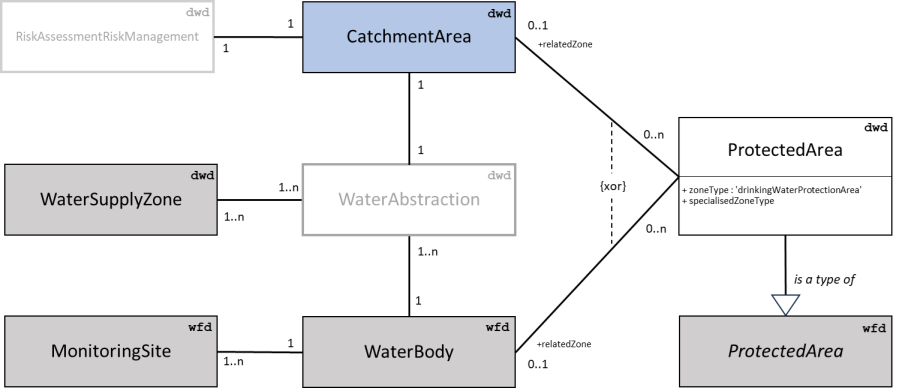

# Introduction

## Purpose and structure of the document

The present document provides guidance to Member States in reporting the
information required under Article 18.1(b) of the [recast Drinking Water
Directive](https://eur-lex.europa.eu/eli/dir/2020/2184/oj) 2020/2184/EC on the quality of water intended for human consumption. If you need further assistance, please contact dwd.helpdesk@eionet.europa.eu.
The document consists of three chapters.

- Chapter 1 gives information about the legal context, rules, components, and purpose of the reporting for the recast Drinking water Directive (DWD) six-yearly data sets on risk assessment and risk management (RA/RM) of the catchment areas for abstraction points.
- Chapter 2 describes the data content and structure that must be followed to report the DWD descriptive data sets. Member States must follow the reporting templates when submitting the data in the [Reportnet 3 platform](https://reportnet.europa.eu/).
- Chapter 3 describes supporting documentation in ancillary documents or in national websites which Member States may provide.
- Chapter 4 describes the data content and structure that must be followed to report the DWD reference spatial data sets. It refers to the WISE GIS Guidance which describes the structure of spatial data sets.
- Chapter 5 describes the alignment and consolidation with data already provided under different reporting dataflows and explains where the datasets may be updated, if needed, in preparation for DWD reporting. The reuse of data already reported facilitates the reporting processes both at national and at European level. Most of the spatial datasets related to DWD risk assessment reporting has already been reported under other reporting obligations.

## Legal context and general approach

By 12 July 2027, pursuant to Article 18.1 (b) of the recast DWD, Member States have to set up data sets containing information related to RA/RM of the catchment areas for abstraction points carried out in accordance with Article 8. Member States must update these data sets every six years thereafter. Pursuant to Article 18.2 of the recast DWD, Member States must ensure that the European Commission, the European Environment Agency (EEA) and the European Centre for Disease Prevention and Control have access to the data sets.
To harmonise the Member States' data sets and the data transfer to the European Commission, whilst considering the technical reporting possibilities within the Member States, DG Environment has organised several expert group meetings, a written consultation, a testing phase (ongoing) as well as a workshop (forthcoming) on the recast DWD reporting in relation with RA/RM. Based on these exchanges with Member States, a reporting template and a reporting mechanism were defined. The reporting template will enable Member States to report the DWD six yearly data sets on RA/RM via the EEA [Reportnet 3 platform](https://reportnet.europa.eu/).

## General rules for reporting

The following general rules apply to the reporting under Article 18.1 (b) of the recast DWD 2020/2184/EC in accordance with Article 8:

- Reporting by Member States to the European Commission shall be made in electronic format to the EEA Reportnet 3 platform.
- The data to be submitted shall be in accordance with the Article 18 provisions of the recast DWD. Supportive information may be supplied by the Member States in the form of document files but that is not mandatory.
- The data shall be structured according to the reporting format (templates) and modalities described in this document.
- Descriptive data can be structured using an Excel reporting template, to facilitate the data transfer. [^1]
[^1]: [System-to-system data transfer via the Reportnet 3 API is also possible – refer to the [technical guidance](https://www.eionet.europa.eu/reportnet/docs/prod/api_howto_reportnet3)]
- Spatial reference data can be structured using a Geopackage template, to facilitate the data transfer. [^1]
- Member States shall be responsible for the annually updated data set reporting to the European Commission and for the accuracy of the reported data.

## Components of the reporting

The reporting under Article 18.1 (b) of the recast DWD 2020/2184/EC in accordance with Article 8 contains descriptive data sets (Chapter 2), supporting documents with metadata (Chapter 3), spatial data sets (Chapter 4) and data sets aligned with other data flows (i.e. these can be updated by reporters within other data flows, Chapter 5). The linkage between these data sets is described in the following chapter.

### The data model

The conceptual data model for the electronic reporting under Article 18.1 (b) of the recast DWD 2020/2184/EC in accordance with Article 8 is based on the following assumptions:
- Each drinking water abstraction point is located in one surface water body, or in one groundwater body. A monitoring site can be located in this water body and is the primary reporting unit for monitoring results.
- Each drinking water abstraction point has a physical catchment area or watershed.
- Each drinking water abstraction point provides water to one or more water supply zones.
- The primary reporting unit for the risk assessment and risk management is the catchment area. Catchment areas are defined by the Member States.

The following sections provide a brief narrative description of the classes and relationships of the class diagram (Figure 1-1).

***Notes:***
*wfd - reported under Water Framework Directive (WFD)
dwd – reported under Drinking Water Directive (DWD)
grey and blue box – spatial data set
white box – descriptive data set*
