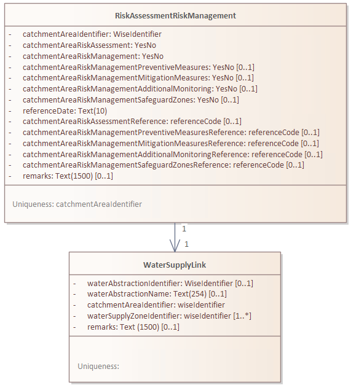

# GUIDANCE DOCUMENT ON REPORTING UNDER THE RECAST DRINKING WATER DIRECTIVE 2020/2184/EC

## Introduction

### Purpose and structure of the document

The present document provides guidance to Member States in reporting the
information required under Article 18.1(b) of the [recast Drinking Water
Directive](https://eur-lex.europa.eu/eli/dir/2020/2184/oj) 2020/2184/EC on the quality of water intended for human consumption. If you need further assistance, please contact dwd.helpdesk@eionet.europa.eu.
The document consists of three chapters.

- Chapter 1 gives information about the legal context, rules, components, and purpose of the reporting for the recast Drinking water Directive (DWD) six-yearly data sets on risk assessment and risk management (RA/RM) of the catchment areas for abstraction points.
- Chapter 2 describes the data content and structure that must be followed to report the DWD descriptive data sets. Member States must follow the reporting templates when submitting the data in the [Reportnet 3 platform](https://reportnet.europa.eu/).
- Chapter 3 describes supporting documentation in ancillary documents or in national websites which Member States may provide.
- Chapter 4 describes the data content and structure that must be followed to report the DWD reference spatial data sets. It refers to the WISE GIS Guidance which describes the structure of spatial data sets.
- Chapter 5 describes the alignment and consolidation with data already provided under different reporting dataflows and explains where the datasets may be updated, if needed, in preparation for DWD reporting. The reuse of data already reported facilitates the reporting processes both at national and at European level. Most of the spatial datasets related to DWD risk assessment reporting has already been reported under other reporting obligations.

### Legal context and general approach

By 12 July 2027, pursuant to Article 18.1 (b) of the recast DWD, Member States have to set up data sets containing information related to RA/RM of the catchment areas for abstraction points carried out in accordance with Article 8. Member States must update these data sets every six years thereafter. Pursuant to Article 18.2 of the recast DWD, Member States must ensure that the European Commission, the European Environment Agency (EEA) and the European Centre for Disease Prevention and Control have access to the data sets.
To harmonise the Member States' data sets and the data transfer to the European Commission, whilst considering the technical reporting possibilities within the Member States, DG Environment has organised several expert group meetings, a written consultation, a testing phase (ongoing) as well as a workshop (forthcoming) on the recast DWD reporting in relation with RA/RM. Based on these exchanges with Member States, a reporting template and a reporting mechanism were defined. The reporting template will enable Member States to report the DWD six yearly data sets on RA/RM via the EEA [Reportnet 3 platform](https://reportnet.europa.eu/).

### General rules for reporting

The following general rules apply to the reporting under Article 18.1 (b) of the recast DWD 2020/2184/EC in accordance with Article 8:

- Reporting by Member States to the European Commission shall be made in electronic format to the EEA Reportnet 3 platform.
- The data to be submitted shall be in accordance with the Article 18 provisions of the recast DWD. Supportive information may be supplied by the Member States in the form of document files but that is not mandatory.
- The data shall be structured according to the reporting format (templates) and modalities described in this document.
- Descriptive data can be structured using an Excel reporting template, to facilitate the data transfer. [^1]
[^1]: [System-to-system data transfer via the Reportnet 3 API is also possible – refer to the [technical guidance](https://www.eionet.europa.eu/reportnet/docs/prod/api_howto_reportnet3)]
- Spatial reference data can be structured using a Geopackage template, to facilitate the data transfer. [^1]
- Member States shall be responsible for the annually updated data set reporting to the European Commission and for the accuracy of the reported data.

### Components of the reporting

The reporting under Article 18.1 (b) of the recast DWD 2020/2184/EC in accordance with Article 8 contains descriptive data sets (Chapter 2), supporting documents with metadata (Chapter 3), spatial data sets (Chapter 4) and data sets aligned with other data flows (i.e. these can be updated by reporters within other data flows, Chapter 5). The linkage between these data sets is described in the following chapter.

#### The data model

The conceptual data model for the electronic reporting under Article 18.1 (b) of the recast DWD 2020/2184/EC in accordance with Article 8 is based on the following assumptions:
- Each drinking water abstraction point is located in one surface water body, or in one groundwater body. A monitoring site can be located in this water body and is the primary reporting unit for monitoring results.
- Each drinking water abstraction point has a physical catchment area or watershed.
- Each drinking water abstraction point provides water to one or more water supply zones.
- The primary reporting unit for the risk assessment and risk management is the catchment area. Catchment areas are defined by the Member States.

The following sections provide a brief narrative description of the classes and relationships of the class diagram (Figure 1-1).

***Notes:***
*wfd - reported under Water Framework Directive (WFD)
dwd – reported under Drinking Water Directive (DWD)
grey and blue box – spatial data set
white box – descriptive data set*

#### Data model classes

C1 - **A CatchmentArea** may include one or more abstraction points, in the same water body, if the risk profile is homogenous. A CatchmentArea is uniquely identified by a catchmentAreaIdentifier. The location of each CatchmentArea is reported using a polygon geometry.
C2 – For the purposes on the electronic reporting, an **WaterAbstraction** is a logical node representing a withdrawal of water. It can represent a single physical abstraction point or a group of abstraction points within one WaterBody. Each WaterAbstraction is associated with a CatchmentArea. Each abstraction is uniquely identified by a **waterAbstractionIdentifier**. *Note: the concept implies a location but <u>does not</u> require the reporting of a geometry.*
C3 – A **WaterSupplyZone** is the distribution area where the water is consumed. A water supply zone receives water from one or more water abstractions. *Note: The water supply zones are reported under the DWD exceedances, incidents and derogations - Article 18.1 (c, d, e) dataflow.*
C4 – A **WaterBody** is the WFD management unit (groundwater or surface water) where the abstraction physically occurs. *Note: the WFD water bodies are reported under the WISE Spatial electronic reporting.*
C5 – A **MonitoringSite** is a location in the WaterBody used to verify the quality of the water for the catchment area risk assessment. *Note: the WFD monitoring sites are reported under the WISE Spatial electronic reporting.*
C6 – Within each CatchmentArea, Member States may define zero or more safeguard zones. Such drinking water protection zones may protect the water abstraction, one or more geographical areas in the catchment area (e.g. recharge zones), or even the entire catchment area. Each **ProtectedArea** is uniquely identified by a **protectedAreaIdentifier**. The location of each ProtectedArea is reported using single or multipart geometries. Member States <u>may</u> restrict the publication of the location of safeguard zones for water abstractions, using a **confidentialityStatus** value.
C7 – The synthesis of **RiskAssessmentRiskManagement** plan is provided for each CatchmentArea.

#### Data model relationships

The model is centred on the CatchmentArea as the main entity for the Risk AssessmentRiskManagement plan, and the concept of WaterAbstraction as the logical link between the resource (WaterBody) and the consumer (WaterSupplyZone).

##### R1 - CatchmentArea [1] ↔ [1] WaterAbstraction

- *Logic*: A Member State defines a CatchmentArea for the purpose of risk assessment. The catchment area must contain at least one abstraction point but may potentially contain various abstraction points. The identity and location of the physical abstraction points is not needed and is not requested. The set of abstraction points for which the catchment area risk assessment was performed is encapsulated in the concept of WaterAbstraction.
- *Note*: This satisfies the requirement that a CatchmentArea can cover multiple abstractions points and that the location of the abstraction points is not requested.

##### R2 - WaterBody [1] ↔ [1..n] WaterAbstraction

- *Logic*: Every WaterAbstraction must be assigned to exactly one WaterBody. A water body may have several physical abstraction points, aggregated into one or more WaterAbstraction.
- *Note*: If the risk profile is similar for all abstraction points in the water body, they may be aggregated into a single WaterAbstraction with a single CatchmentArea risk assessment. In other circumstances, the risk assessment may be done for different subsets of abstractions points in the waterbody (e.g. the subset of abstraction points supplying a densely populated water supply zone vs less critical abstraction points).
- *Note*: The WaterAbstraction has no geometry. Its location is logically defined by its parent WaterBody and the CatchmentArea it belongs to.

##### R3 - WaterAbstraction [m] ↔ [n] WaterSupplyZone

- *Logic*: This is a many-to-many relationship. Water from one WaterAbstraction (logical unit) can be distributed to multiple WaterSupplyZone. One WaterSupplyZone can receive water from multiple WaterAbstraction.

##### R4 - CatchmentArea [0..1] ↔ [0..n] ProtectedArea

- *Logic*: To manage risks found in the CatchmentArea, safeguard zones may be defined. There may be zero (if no significant risks) or many protected areas. The ProtectedArea geometry is reported using single or multipart geometries.
- *Technical note*: If more than one CatchmentArea exists per WaterBody, the ProtectedArea should be linked to a specific CatchmentArea. That will be denoted by relateZoneIdentifier = CatchmentAreaIdentifier.thematicIdIdentifier AND relatedZoneIdentifierScheme = CatchmentAreaIdentifier.thematicIdIdentifierScheme.
- *Special case*: If the safeguard zone encompasses the entire catchment area, that will be denoted by the value specialisedZoneType = 'catchmentArea'.

##### R5 - WaterBody [0..1] ↔ [0..n] ProtectedArea

- *Technical note*: If only one CatchmentArea exists per WaterBody, the ProtectedArea should be linked to directly to the water body. That will be denoted by relateZoneIdentifier = WaterBody.thematicIdIdentifier AND relatedZoneIdentifierScheme = WaterBody.thematicIdIdentifierScheme.
- *Special case*: If the safeguard zone encompasses the entire water body, that will be denoted by the value specialisedZoneType = 'waterBody'.

##### R6 - WaterAbstraction [0..1] ↔ [0..n] ProtectedArea

- *Technical note*: There will be no direct link between the ProtectedArea and the WaterAbstraction. Instead, the approach defined before should be followed: 1) if only one CatchmentArea exists per WaterBody, the ProtectedArea should be linked to directly to the water body; 2) if more than one CatchmentArea exists per WaterBody, the ProtectedArea should be linked to a specific CatchmentArea.
- *Special case*: If the safeguard zone is designed to directly protect the abstraction points (e.g. protection perimeters around groundwater abstraction points), that will be denoted by the value specialisedZoneType = 'waterAbstractionSafeguardZone'.
- *Special case*: Member States may limit public access to spatial data sets where such access would adversely affect inter alia the public security or the protection of the environment. The publication of the location of the safeguard zones may be prevented by specifying confidentialityStatus = 'N'. (Note that the same approach is already use for monitoring sites that are co-located with the abstraction points.)

##### R7 - CatchmentArea [1] ↔ [1..n] MonitoringSite

- *Logic*: While the monitoring site physically sits in a WaterBody, for this specific reporting flow, it provides data validation for the CatchmentArea risk assessment.
- *Technical note*: The relationship can be obtained via CatchmentArea [1] ↔ [1] WaterAbstraction [1] → [1] WaterBody [1] ← [1..n] MonitoringSite and the spatial condition ST_Within(MonitoringSite.geometry, CatchmentArea.geometry) = TRUE.
- *Note*: <u>Optionally</u>, Member States may wish to detail the subset of monitoring sites relevant for drinking water monitoring. That information is provided in the MonitoringSite.purpose attribute.

### How the European Commission and the EEA will use the information

The information provided every six years by the Member States under Article 18.1 (b) of the recast DWD 2020/2184/EC in accordance with Article 8 will be used for the following purposes:

- To assess whether the implementation of the requirements of the recast DWD is sufficient in each Member State (i.e., compliance assessment).
- To enable the European Commission to monitor and assess the implementation of the recast DWD in relation to the objectives it pursues, to inform any future evaluation of this Directive in accordance with paragraph 22 of the Interinstitutional Agreement of 13 April 2016 on Better Law-Making.
- At EU and Member State level, for the assessment of risks in catchment areas and the corresponding measures, particularly with regard to critical pollutants that lead to exceedances of the parametric values in the water supply zone (annual reporting of exceedances).
- The data assessed by the European Commission can be presented at catchment area level, and as aggregated information at national and EU levels. The European Commission requires data at catchment area level to properly assess the DWD implementation.
- The EEA may use the information to supplement the data collected through other reporting streams when producing European, pan-European and regional integrated environmental data and indicator sets, assessments and thematic analyses.
- According to Article 18.3 of the recast DWD, the EEA shall publish and update a Union-wide overview using the data provided by the Member States on a regular basis or upon request from the European Commission.

## Descriptive data

This section presents the descriptive data relevant for the reporting under Article 18.1 (b) in accordance with Article 8 of the recast DWD, specifically the RiskAssessmentRiskManagement dataset and the WaterSupplyLink dataset (Figure 2-1).

***Figure 2-1 Class diagram for the tables RiskAssessmentRiskManagement and WaterSupplyLink.***

### Table: RiskAssessmentRiskManagement

**Description**: The RiskAssessmentRiskManagement dataset provides an overview of the status of the risk assessment and risk mangement for each catchment area, for a given reference date. It is a simple questionnaire, allowing Member States to provide support documentation in ancillary documents or in national sites. 
**Uniqueness**: catchmentAreaIdentifier 
**Quality Checks**:
- **R004**: If catchmentAreaRiskManagementSafeguardZones = 'yes', then the safeguard zones must have been reported under the ProtectedArea dataset.
- **XC003**: There are identifiers reported in spatial catchmentArea dataset that are missing in this table
- **TU001**: The field catchmentAreaIdentifier must be unique within table

| Field | catchmentAreaIdentifier |
| :--- | :--- |
| **Guidance on completion** | European Persistent Unique Identifier of the CatchmentArea. |
| **Field type** | WiseIdentifier |
| **Properties** | minOccurs: 1  maxOccurs: 1 |
| **Quality Checks** | V005: The value must not be missing or empty V026: The value is not a valid member of the referenced list. XC001: catchmentAreaIdentifier must match a CatchmentArea thematicIdIdentifier in Spatial dataset where wiseEvolutionType != 'deletion'. |
